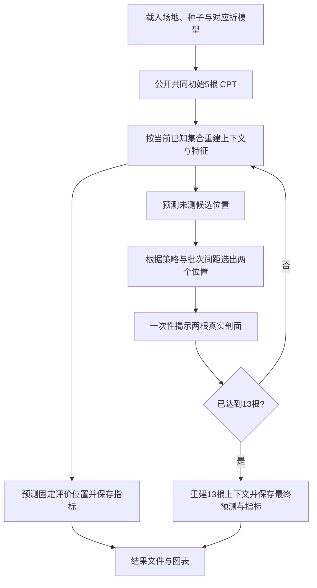
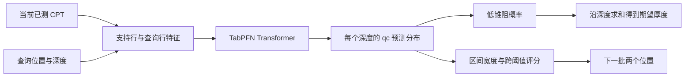

# CA6001 CPT 项目实现蓝图

> 版本：1.1 · 2026-10-13（呈现、可视化与配套输出修订）  
> 项目：面向低锥阻层识别的预算受限 CPT 补勘——表格基础模型迁移与自适应选址  
> 用途：指导数据、模型、回放实验和课程交付的协作开发。本文给出待实现的项目结构与接口，不表示这些程序或模型已经完成。

## 1. 项目完成时应当具备什么

交付一套本地可运行的 Python 实验系统：从已有 CPT 文件生成统一数据，利用历史场地训练模型，在未见场地模拟“初始 5 根、每轮追加 2 根”的补勘过程，输出预测剖面、低锥阻厚度、下一批位置以及预算—质量曲线。模型效果、选址效果和成本解释由同一条数据流程产生。

主线分成两个相互独立、最终组合的能力：

1. **预测器**：输入当前已测 CPT 与查询位置，输出深度方向的阻力预测；具备分布输出的模型还返回低锥阻概率和预测区间。
2. **选址器**：输入候选位置及预测结果，在共同预算和距离约束下推荐两个补勘位置。

主模型采用 **TabPFN v2 回归权重 + 按场地、整根 CPT 构造的微调任务**。主决策改进是低锥阻敏感的不确定性选址。保留 IDW、空间 GP、同特征 XGBoost 和未微调 TabPFN，形成有解释力的对照。

### 1.1 统一任务口径

| 项目 | 主实验决定 |
|---|---|
| 预测对象 | 未测位置的 `log(qc_MPa)`；最终同时输出 MPa |
| 深度范围 | 记录深度 2–8 m；保存各场地深度基准，不解释为统一地层标高 |
| 深度单元 | 24 个 0.25 m 区间，中心点 2.125、2.375、…、7.875 m |
| 低锥阻阈值 | 主阈值 1 MPa；0.5、2 MPa 作为固定的敏感性分析 |
| 预算单位 | 一个不同位置上的一根代表 CPT；同坐标重复文件不重复计费 |
| 回放预算 | 累计 5、7、9、11、13 根；每轮两根、最多四轮 |
| 主模型信息 | 历史训练场地 + 当前目标场地已揭示剖面 |
| 回放范围 | 已有离散候选位置；不进行连续空间最优布点 |
| 核心结论 | 固定预算下的预测质量，以及同等质量下的补勘数量变化 |

### 1.2 最终成果

- 一套命令行入口，能从现有数据运行到结果汇总，支持按阶段续跑。
- 每个外层数据划分对应的模型与配置；目标场地推断使用与该场地隔离的模型。
- 可直接画图的预测、推荐、预算曲线和逐场地汇总表。
- 六类可复用图形：场地布局、模型机制、剖面与区间可靠性、选点解释、逐场地与预算比较、达标预算与条件成本；按报告和演示需要组合。
- 报告版与幻灯片版两套排版，以及围绕 New Lock 场地的逐帧补勘视频。
- 10 页以内的报告、12 张内容幻灯片、15 分钟以内的录制及可运行代码。

先完成数据—预测—回放—结果的闭环，再增加展示界面。Delft 场景、0.1 m 深度敏感性属于主线完成后的扩展。

## 2. 从当前 Data 目录接入

现有 `Project/Data` 已包含可复用的筛选结果与原始数值，不需要先重新解析整个数据库。所有新增程序都以本项目根目录 `Project/` 为基准解析路径，兼容 Windows 路径中的空格和 `&`。

### 2.1 直接复用的输入

| 现有文件或目录 | 在新系统中的作用 |
|---|---|
| `Data/cpt_screened_spatial_profiles.json` | 主数据注册表的输入：503 根候选剖面的场地、源文件、局部坐标与数组键 |
| `Data/cpt_screened_depth_qc.npz` | 主数值输入；每个键对应不等长的 `(n, 2)` 数组，列为记录深度和 qc，尚不是 24 点网格 |
| `Data/cpt_project_scope_audit.json` | 当前数据规模参考；正式程序的实际数量由读取后的数据生成 |
| `Data/cpt_target_variation.json` | 初始场地选择和案例理解的辅助资料；正式标签由统一网格重新计算 |
| `Data/downloads/Global_CPT1196.zip` | 补取源表、经纬度和必要元数据；需要追溯时才读取原始工作簿 |
| `Data/downloads/Delft_Dyke_CPT100.zip` | 可选 Delft 场景输入，独立接入 |
| `Data/audit_cpt_multisite.py`、`Data/audit_cpt_legacy_and_scope.py` | 提取已有解析逻辑的参考，不作为每次训练必须重跑的步骤 |

旧 `cpt_spatial_preflight.json`、`cpt_multisite_profiles.json` 和旧数值文件保留在原处，但主流水线不从旧的 423 根口径启动。设计说明中的 `research/downloads/` 在当前工作区对应 `Data/downloads/`。

`array_key` 是 JSON 与 NPZ 的连接键。普通剖面使用诸如 `"1"` 的键；New Lock 使用诸如 `legacy_DKMP10_000` 的键。禁止根据列表顺序、文件夹排序或文件数字编号猜测对应关系。

### 2.2 主场景清单

当前 503 根剖面对应 495 个不同的场地内坐标位置。对同坐标组，选择已满足主窗口条件且源文件路径按字典序最小的剖面作为代表，其他剖面保留登记但不额外进入主训练或回放。代表选择不使用 qc、低锥阻厚度或模型结果。

采用“最终可用不同位置数至少为 20”的统一规则选择正式回放场地，目前对应：

| 场地 | 候选剖面数 | 不同位置数 | 展示侧重点 |
|---|---:|---:|---|
| New Lock | 80 | 80 | 主案例，完整展示四轮补勘 |
| Christchurch Metro Sports Facility | 39 | 39 | 跨场地预测与选址 |
| Lower Hutt Town Hall | 29 | 29 | 低锥阻较少的情况 |
| Tauranga Farmers Building | 28 | 28 | 地层差异明显的情况 |
| Wellington Airport | 27 | 27 | 当前窗口下的低锥阻阴性场景 |
| Hollywood | 25 | 25 | 中等规模补勘场景 |
| Christchurch Stadium | 30 | 23 | 按位置合并后参与回放 |
| Marshland | 20 | 20 | 较小场地上的预算效果 |

若规范化后个别位置不满足统一条件，按同一规则重新生成名单，不按模型表现筛选。其余合适的小场地可用于源任务训练和静态评价。New Lock 已包括在 Global 数据中，不追加计算一次独立数据集。

## 3. 建议项目结构

采用一个 Python 包、一个配置目录和一个运行结果目录。每个模块直接对应数据处理、模型或实验职责，避免引入服务端、任务队列和数据库。

```text
Project/
├── CA6001_CPT_高分项目设计.md             # 已有：研究目标与范围
├── CA6001_CPT_项目实现蓝图.md             # 本文：开发依据
├── CA6001 Assignment Brief.pdf
├── CA6001 Report Template.docx
├── README.md                            # 安装、最短运行、结果入口
├── pyproject.toml                       # Python 包与依赖
├── requirements-lock.txt                # 首次跑通后冻结的实际版本
├── configs/
│   ├── main.yaml                        # 任务、预算、模型与输出配置
│   ├── sites.yaml                       # 场地标识、基准、坐标与勘察簇
│   ├── presentation.yaml                # 配色、输出尺寸、图形选取与案例规则
│   └── pilot.yaml                       # 小规模开发配置，沿用相同流程
├── Data/                                # 已有输入保留原位
│   ├── downloads/
│   ├── cpt_screened_spatial_profiles.json
│   ├── cpt_screened_depth_qc.npz
│   └── ...
├── data_processed/                      # 程序生成
│   ├── profiles.parquet                 # 剖面与位置注册表
│   ├── grid.parquet                     # 24 单元主任务数据
│   ├── sites.parquet                    # 场地及空间元数据
│   ├── folds.json                       # 外层测试、内部验证与源训练组
│   ├── episodes.parquet                 # 微调任务的支持/查询位置清单
│   └── replay_splits.json               # 各场地各种子的固定评价集与起点
├── src/cpt_budget/
│   ├── __init__.py
│   ├── __main__.py                      # 单一命令行入口
│   ├── config.py                        # 配置、路径与随机种子
│   ├── types.py                         # 核心对象与列定义
│   ├── data/
│   │   ├── import_existing.py           # 连接已有 JSON/NPZ
│   │   ├── source_metadata.py           # 按需补取坐标和基准
│   │   ├── normalize.py                 # 位置代表、深度网格、标签
│   │   ├── splits.py                    # 勘察簇、外层划分、回放划分
│   │   └── episodes.py                  # 按整根 CPT 构造任务
│   ├── features.py                      # 同一份邻域特征实现
│   ├── models/
│   │   ├── base.py                      # 统一预测器接口
│   │   ├── idw.py
│   │   ├── gp.py
│   │   ├── xgb.py
│   │   ├── tabpfn_adapter.py            # 官方接口的版本适配层
│   │   ├── tabpfn_train.py              # 按场地 episode 微调
│   │   └── distribution.py              # 统一分布解码与低锥阻概率
│   ├── acquisition.py                   # maximin、不确定性、阈值敏感规则
│   ├── replay.py                        # 逐轮状态与整批揭示
│   ├── evaluate.py                      # 静态比较、逐剖面及逐场地指标
│   ├── economics.py                     # 同质量预算和条件成本
│   ├── plot_style.py                    # 统一颜色、字体、轴与双套输出预设
│   ├── figures.py                       # 共用绘图函数与报告/幻灯片组合
│   └── pipeline.py                      # 串联阶段、复用已有产物
├── runs/<run_id>/
│   ├── run.json                         # 实际配置、版本、阶段完成状态
│   ├── checkpoints/fold_<k>/            # 模型和预处理配置
│   ├── predictions/                     # 静态与回放预测表
│   ├── recommendations.parquet          # 每轮推荐位置和分数
│   ├── acquisition_scores.parquet       # 首轮全部候选的评分与几何约束
│   ├── metrics.parquet                  # 每场地/种子/预算的指标
│   ├── summary/                         # 汇总表及成本目标
│   ├── figures/report/                  # 按最终页面尺寸导出的 SVG/PDF/PNG
│   ├── figures/slides/                  # 16:9 幻灯片专用 SVG/PNG
│   └── demo/                            # 帧序列、旁白提纲和 MP4
└── deliverables/
    ├── report/
    ├── slides/
    └── recording/
```

`data_processed/` 保存与具体模型无关的任务数据；`runs/` 保存某次配置下的模型与结果。原始 Data 不被训练程序覆写。开发初期不需要生成树中所有空目录，随对应功能落地创建。

## 4. 数据管线与统一数据对象

### 4.1 从原始剖面到任务网格

按以下顺序实现 `prepare`：

1. 读取 screened JSON，以 `array_key` 取得 NPZ 数组，构造稳定的 `profile_id`。源文件路径参与标识，避免不同场地的 `1.xlsx` 冲突。
2. 在场地内按相同坐标建立 `location_id`，按固定规则选择代表剖面。主任务只使用代表；所有成员保留在注册表。
   同时只根据坐标建立 `near_group_id`：不同位置之间距离小于 2 m 则连边，连通分量用于场地内的支持/查询及评价/行动分组，不合并其剖面和计费单位。该半径是实验划分的保守设置，不是地质相关长度；不能仅凭距离就把两个不同观测认定为重复或信息泄漏。
3. 保留原始局部坐标，按需要补取经纬度和深度基准。新西兰部分原坐标表含经纬度列，可用来判断跨场地的近邻关系；不能将两个场地各自居中的局部坐标直接比较。
4. 对每根代表剖面的有效正 qc 数据，在 24 个中心点上作线性插值。只在已有数据覆盖区间内插值，跨越超过 0.5 m 缺口的单元不填补；主任务要求 24 个单元全部可用。
5. 以 MPa 存储 qc，计算自然对数 `log_qc`；不再通过任意小常数把无效值变成有效测量。
6. 根据三个固定阈值生成单元标签和窗口内厚度。已有 JSON 中的 `H_below_threshold_m_2_10m` 属于不同窗口，不直接沿用。
7. 输出注册表、网格表和场地表，再生成分组与任务；邻域特征此时尚不生成。

主深度口径保持 `recorded_depth_m`。具备足够标高/倾角信息的场地可以另做物理深度订正，但不在主数据中混用订正与未订正坐标。

图形保留原始有效采样点与 0.25 m 中点网格两种表示。原始采样间距按各文件实际记录标注，不统一写成 0.02 m。主厚度仍用中点网格计算，不改成单元内最小 qc；后者会将极薄的低值扩张成整个 0.25 m 单元。薄层敏感性单独用 0.1 m 配置处理，不能根据原型的近似统计宣称主任务已完整保留全部薄层。

### 4.2 数据表约定

| 表或对象 | 最小字段 | 用途 |
|---|---|---|
| `profiles` | `profile_id, site_id, location_id, near_group_id, source_file, array_key, x_m, y_m, longitude, latitude, is_representative, depth_reference` | 区分同坐标位置组和近邻划分组；全球位置缺失时明确留空 |
| `sites` | `site_id, display_name, investigation_group, coordinate_reference, longitude, latitude, geometry_scale_m, n_locations, replay_eligible` | 分组、几何尺度、显示名称、场地选择 |
| `grid` | `profile_id, location_id, depth_index, z_center_m, qc_mpa, log_qc, low_0_5, low_1, low_2` | 标签真值；完整表只由数据与评估模块持有 |
| `Episode` | `fold, role, site_id, episode_id, support_location_ids, query_location_ids, seed` | 一次整根 CPT 预测任务；只保存 ID 列表 |
| `ObservedSet` | 已揭示 `location_id`、坐标和 24 点测量 | 预测器唯一可以看到的目标场地测量 |
| `QueryGrid` | 查询 `location_id`、坐标和深度 | 不携带 qc、厚度或标签 |
| `PredictionBundle` | 点预测、可选区间/概率、厚度以及模型标识 | 对接策略、指标、图表 |

NPZ 的原始不等长数组可以继续作为底层数据。Parquet 是分析与实验的中间格式，CSV 仅用于最终便于查阅的汇总表，不重复维护多套主数据。

### 4.3 共享邻域特征

首先实现一套 16 个数值特征：查询深度；最近三根已知 CPT 在同深度的 `log_qc`；对应三项 `log1p(distance_m / geometry_scale_m)`；三个邻居有效标识；已知邻域同深度的均值、标准差和中位数；该深度的 IDW 估计；可用支持位置数；场地尺度 `log1p(geometry_scale_m / 1 m)`。标准差采用总体口径；缺少邻居时填缺失并保留有效标识。

`geometry_scale_m` 为该场地预先已知的全部计划位置中，每个不同位置最近邻距离的中位数，按几何清单在回放开始前计算并冻结。这些坐标可包含评价位置，因为候选坐标本来就是允许知道的信息，但不读取它们的 qc。若使用情景没有完整计划位置清单，就用初始已知位置的几何尺度并冻结，且单独标明该情景。尺度不能每轮随已测集合改变。

同时保留相对距离与单独的物理尺度，既帮助模型识别“相对于当前布点有多远”，又不会抹掉 4 m 与 56 m 的实际差异。尺度只是布点密度，不直接解释为地质相关长度。GP 核、IDW 的距离和批次间距仍使用真实米制距离；统一除以同一场地尺度不会改变归一化 IDW 权重。

查询位置只从当前 `ObservedSet` 取邻居。为支持集中的位置构造训练/上下文行时，则先排除这个位置的整条剖面及其同坐标组，再构造邻域特征。均值、离散程度、IDW 和支持数量也使用排除后的集合。这样自己的 qc 不会通过距离为零的邻居或背景统计进入自己的输入。

XGBoost、未微调 TabPFN 和微调 TabPFN 共用此函数、列顺序和缺失规则。对某个源训练场地换一个公开集合，或回放新增了两根 CPT，都需要重算受影响的特征，不能从“全场地特征表”切片代替。

第一版不加入场地 ID、国家绝对坐标、目标点 fs/u2、真实厚度或由隐藏剖面推导的土类。相邻深度摘要可作为主线完成后的一项小扩展，不进入首轮特征搜索。

## 5. 场地划分与训练任务

### 5.1 三折划分

先在 `configs/sites.yaml` 固定 `site_id → investigation_group`。确认属于同一项目、重叠地点或紧邻勘察簇的场地共用一组。全局坐标用于分组，局部米制坐标用于场地内部建模，两者用途分开。

分组初始规则取 250 m 近邻半径：补取各位置经纬度后，计算场地之间任意两位置的最短球面距离；距离不超过 250 m，或明确共享同一原始勘察任务/重复观测时连接两个场地，连通分量作为完整组。该半径是预先固定的数据划分参数，不是已测地质相关长度。共同使用 TC304 数据库本身不构成合组理由；不按城市名称合并，也不强制每个场地连接最近邻。无法恢复全球位置时依据原始项目说明确定组，不能用局部坐标猜测。

将勘察组按不同位置数降序排列，依次放入当前位置总数最少的外层折，同时尽量平衡可回放场地数，固定随机种子处理并列。每个组完整进入一折。形成三个外层测试折后，对每折剩余源数据再按整组选取约 20%–25% 的位置作为验证集，尽量包含两个能进行完整回放的场地组，其余作为训练集。

`folds.json` 明确保存 `train_groups / validation_groups / test_groups`。全局参数、XGBoost 权重和 TabPFN 微调只使用训练组；早停和配置选择只使用验证组。被测场地初始及后续揭示的 CPT 可用于该场地上下文推断，但不进入源模型梯度训练。

每个测试场地只使用自己所属外层折的 checkpoint。正式评价不加载在全部场地上训练的模型。组规模不均时保留实际折规模，不通过拆开近邻组追求三折数量相等。

### 5.2 Source episode：模拟少量已测条件

每个 episode 来自一个训练场地，由已公开支持位置 `S` 和整根查询位置 `Q` 组成：

```text
X_support = features(S, S，逐位置排除自己)
y_support = S 的已知 log(qc)
X_query   = features(S, Q)
y_query   = Q 的真实 log(qc)，只交给损失函数
```

每个场地最多预生成三个固定遮蔽情景，目标支持数为 5、9、13；小场地取 `min(目标支持数, n_locations - 1)`。支持数不足 5 的情景不进入主微调。至少 6 个位置的场地可以贡献一个“5 根支持 + 1 根查询”任务，不将多个无空间关系的小场地拼成一个场地。

支持/查询边界按 `near_group_id` 处理：先按固定种子划分近邻组到支持侧与查询侧，再在支持侧取所需根数。支持侧未被选择的位置不转为查询标签；查询批次只从查询侧取完整剖面。这样不需要把一个近邻组免费全部公开，也不会为精确凑 5/9/13 根而把同一近邻组拆到边界两侧。无法构成至少 5 根支持和一根查询的情景跳过；预先固定的几何场景不能根据标签或模型表现重选。

一个训练批次包含一个 episode，query 最多取 8 根完整剖面。最大的批次是 `(13 + 8) × 24 = 504` 行，控制在 512 行开发上限内。多余查询位置跨 epoch 轮换；验证和正式推断则按最多 8 根完整 query 分批覆盖所有查询位置。

每个 epoch 按场地轮转，优先令每个场地贡献相同次数的参数更新；在三个情景之间轮换，避免大场地因查询点多而主导训练。保存的是位置 ID 清单，不复制大量重复深度数据。特征在实际取出 episode 时生成。

### 5.3 Target context：新场地每轮的已测集合

目标场地第 t 轮的上下文由当前已揭示位置 `O_t` 构成。对其中每根剖面使用整位置留一特征，对未知候选与固定评价位置使用完整 `O_t` 的邻域信息。

主方案不额外混入历史 context bank。跨场地知识通过源任务训练进入微调权重；未微调与微调 TabPFN 在目标场地使用完全相同的 120–312 行上下文。这样微调消融只改变权重，目标观测数量、预处理配置和推断预算保持一致。

## 6. 预测器与微调实现

### 6.1 统一项目接口

以下是拟实现的项目接口，不要求各底层库原生具有这些方法：

```text
prepare_data(config) -> PreparedDataset
make_splits(dataset, config) -> FoldManifest
build_features(observed, query_grid, *, leave_location_out) -> FeatureTable
build_episode(dataset, episode_spec) -> EpisodeTensors

fit_source(train_episodes, validation_episodes, config) -> ModelArtifact
load_predictor(model_artifact, config) -> Predictor
predictor.condition(observed) -> None
predictor.predict(query_grid) -> PredictionBundle

select_batch(observed_coordinates, candidate_coordinates, predictions, config) -> list[Recommendation]
evaluate(predictions, evaluation_truth, config) -> MetricRecord
```

`condition()` 的行为按模型实现：GP 根据当前已测数据拟合局部空间模型；TabPFN 重建上下文；XGBoost 保留源训练权重并准备当前邻域。选址模块只依赖 `PredictionBundle`，不依赖 TabPFN 类或训练过程。

### 6.2 固定模型代际和运行环境

- 基础权重：`Prior-Labs/TabPFN-v2-reg` 的 `tabpfn-v2-regressor.ckpt`。
- 开发适配版本：`tabpfn==9.2.0`，初始化显式指定 `ModelVersion.V2`。软件包版本与基础模型代际分别记录。
- Python 3.11；PyTorch 使用与本机驱动兼容的 CUDA 版。首次小任务跑通后保存实际可运行的版本组合，不预先声称某套 CUDA/驱动组合已在 RTX 4080 上验证。
- 基本依赖：NumPy、pandas、PyArrow、SciPy、scikit-learn、XGBoost、PyTorch、TabPFN、PyYAML、Matplotlib；原始元数据补读需要 openpyxl、xlrd。
- 未微调与微调 TabPFN 从同一份 v2 权重出发，主配置都使用 `n_estimators=1`。

本蓝图按固定版本的官方接口设计，模型适配层仍需在实现首日完成一次实际贯通运行。所有版本相关调用集中在 `tabpfn_adapter.py`，业务层只使用项目接口。

### 6.3 为什么需要一个小型 episode 适配训练器

普通 `TabPFNRegressor.fit()` 准备上下文，不执行 CPT 梯度微调。官方 `FinetunedTabPFNRegressor.fit(X, y, X_val, y_val)` 可以更新权重，但该封装未公开整根 CPT 分组或多场地 episode 参数，默认循环会按数据行重新切分 context/query。

因此主线使用 `tabpfn_train.py` 接管任务供给、验证和早停，复用官方的预处理、Transformer 前向传播、分布损失和权重保存。该适配只解决“每次公开哪些整根剖面”这一任务问题，不改模型结构。

### 6.4 微调器的实现链

1. 使用 `TabPFNRegressor.create_default_for_version(ModelVersion.V2, fit_mode="batched", n_estimators=1, ...)` 初始化可微前向模型。
2. 将单个 episode 的 support 行放在前、query 行放在后。调用官方 `get_preprocessed_dataset_chunks`，通过确定性的 `split_fn` 指定整根 support/query 边界；关闭二次随机打散，设置 `shuffle=False, max_data_size=None`。上游已经将总行数限制在 504 以内。
3. 复用官方数据预处理对象，只根据 support 拟合该 episode 的变换和目标中心/尺度，再变换 query。query 标签仅转换到损失所需空间，不参与估计预处理参数。额外 target transform 由固定版本的 `_targets_in_estimator_space` 适配，不自行近似。
4. 根据 `RegressorBatch` 设置该批所需的分布刻度，调用 `fit_from_preprocessed(..., no_refit=True)` 装入 support，保留此前更新的网络参数。
5. 用 `forward(..., use_inference_mode=False)` 得到可微的分布 logits，复用 `_compute_regression_loss`。主损失使用分布负对数似然：`ce_loss_weight=1`，其他辅助损失项为 0。每根 query 恰好 24 行，因此对 query 行均值等价于对各根剖面等权平均。
6. AdamW，学习率 `1e-5`、weight decay `0.01`、梯度范数上限 1.0；复用官方混合精度与 activation checkpointing 路径。
7. 每 epoch 在源验证场地执行正式推断同款的 condition/predict，以逐场地宏平均 log-RMSE 选择最佳微调 checkpoint；最多 10 epoch，连续 3 次不改善早停。
8. 用 `save_tabpfn_model` 保存可重载的权重及配置，另存特征列顺序与 fold 信息。未微调基线单独保存评价；若最佳微调结果仍较差，保留真实微调结果，在展示方法选择时使用验证集决定的更好模型，不把未微调权重改名成微调结果。

这些接口中有版本相关的内部辅助方法。实现时沿用固定版本源码的调用约定，仅在适配层处理其变动；不修改安装包，也不把尚未运行过的适配代码当作现成官方 API。

### 6.5 微调之后，如何在新场地使用

通过显式 v2 配置与 `model_path=checkpoint_path` 加载保存的权重。每轮执行：

```text
当前已测 O_t
  → 生成 O_t 的整位置留一特征及已知标签
  → 普通回归器 fit(X_support, y_support)
  → 为候选/评价位置生成只依赖 O_t 的 query 特征
  → predict(output_type="full", quantiles=[0.05, 0.10, 0.25, 0.50, 0.75, 0.90, 0.95])
  → 输出点值、区间、低锥阻概率
```

这里的普通 `fit()` 替换上下文与预处理器，微调权重不变。不要在目标回放中再次调用微调封装，也不要沿用绑定在历史训练场地上的上下文。

### 6.6 分布与厚度解码

模型接收的标签已经是 `ln(qc / 1 MPa)`。固定版本 `predict(full)` 返回的 raw-space criterion 对应这个输入标签空间；训练内部的标准化不能重复施加到阈值上。

- 点预测取 log(qc) 分布的中位数，指数变换得到 qc 中位数；不把它称为 qc 的期望。
- 90% 区间使用 `q05_log/q95_log`，需要 MPa 时对两端取指数。
- 同时保存 `q10/q90` 构成 80% 区间、`q25/q75` 构成 50% 区间以及 `q50` 中位数；GP 用同一组分位数，保证图和覆盖率定义一致。
- `p_low` 用预测分布 CDF 在 `ln(tau_mpa)` 处计算，CDF 所用 logits 与 criterion 必须来自同一次 `full` 输出。
- 所有模型的共同厚度输出：`H_point = 0.25 × sum(pred_qc < tau)`。
- 有分布的模型另给：`H_expected = 0.25 × sum(p_low)`。这是期望厚度，不需要假设各深度独立。

第一版保留原生区间并报告覆盖率与宽度，不增加一套校准系统；不将逐深度边际分布拼成未经建模的厚度联合置信区间。

七个分位数足以生成三层区间与 50/80/90% 覆盖率图，但不足以重建任意完整分布或精确计算 CRPS。三个固定低锥阻概率直接从当次原生 CDF 计算后落盘。主线不保存每条记录的完整 logits/分布对象，也不承诺从七个分位数计算精确 CRPS；若后续确有评分需求，在推断时用原生分布计算并保存单条得分，避免为展示增加庞大的缓存。

### 6.7 四类对照的具体实现

| 预测器 | 源场地阶段 | 目标场地每轮 | 初始配置及输出 |
|---|---|---|---|
| IDW | 验证配置后固定 | 逐深度按附近已知 log(qc) 插值 | 最近 3 根、距离幂次 2；点值和 `H_point` |
| GP | 从训练场地估计每个深度单元的场地等权平均 log(qc) 趋势，验证核配置 | 减去固定趋势，对当前支持数据拟合空间残差，再加回趋势 | `Constant × Matern(ν=1.5, ARD) + WhiteKernel`；点值、区间、概率、两种厚度 |
| XGBoost | 对源 episode query 行训练；每场地总权重相同，再在其情景/位置/深度间均分 | 重新生成 query 邻域特征，树权重不变 | `reg:squarederror, hist, max_depth=4, learning_rate=0.05, n_estimators≤500`；点值和 `H_point` |
| 未微调 TabPFN | 保留原 v2 权重 | 与微调版完全相同的 context/predict | 一个 estimator；完整分布与厚度 |

GP 输入为场地内米制 `(x,y,z)`，三个方向使用独立核长度尺度；每轮只在当前已知 support 上优化边际似然，最多两个重启。最多 312 行观测，可先实现精确 GP，不另引入稀疏模型框架。区间统一解释为对观测 log(qc) 的预测区间，包含 WhiteKernel 对应噪声。

XGBoost 用验证场地 early stopping，验证指标按场地等权解释；与两种 TabPFN 共用第 4.3 节的 16 列特征。IDW 与 XGBoost 不伪造概率区间，区间指标仅比较 GP 与 TabPFN。

## 7. 补勘回放和选址器

### 7.1 固定回放起点

固定种子 `[17, 29, 43, 71, 101]`。对每个合格场地、每个种子：

1. 以 `near_group_id` 为单位随机划出固定评价集 `E`，目标位置数约为 `ceil(0.20 × n_locations)`。用固定种子为组排序，通过子集选择让评价位置数尽量接近目标，组不可拆开；同时要求行动池至少保留 13 个位置。整个过程只使用坐标和组大小，不参考低锥阻标签。记录实际评价位置数而非强行写成恰好 20%。
2. 剩余位置形成行动池 `P`。从 P 随机选一个锚点，再按最远点规则取足 5 点，得到共同初始集合 `O_0`。
3. 保存 `E/P/O_0`、预算和批次间距参数。所有模型/策略从这份清单重新开始。

New Lock 的目标划分为约 16 个评价位置、64 个行动位置，实际数量服从整组分配。不同位置仍各消耗一根预算；选择一处不同时揭示其近邻组中其余位置。固定评价位置以及它们的近邻组都不允许转为行动点。近邻组过大而无法同时留下评价数据与 13 个行动位置时，将场地标为主预算不适用并单列结果，不按模型表现降低距离门槛或拆组。

近距离观测能帮助预测本来就是空间勘察的工作方式；这里采用整组留出，是避免用几乎重合位置夸大对未测区的评价。它不能证明米级之外完全独立，也不取代第 5.1 节的跨场地分组。每条曲线保留实际评价数和评价位置到初始已测集合的最近距离概况，便于解释初始空间覆盖的影响。

### 7.2 回放引擎的状态转换



核心状态只需 `site_id, seed, round_id, observed_ids, remaining_ids, evaluation_ids, budget_n`。程序按 5/7/9/11/13 依次预测和记录，在 13 根时不再选点。

数据仓库提供 `reveal_batch(selected_ids)`，评价器单独读取 `E` 的真值。策略收到的对象只有已知观测、候选坐标和候选预测，不含评价误差或隐藏真值。第二点确定之前不揭示第一点的真实剖面，维持“一批两点”的信息条件。

### 7.3 三个可替换策略

**空间覆盖 `maximin`：** 第一点评分为到所有已测位置的最近距离；第一点选定后只将其坐标加入覆盖集合，再选择第二点。该策略不使用预测值。

**普通不确定性 `uncertainty`：** 累加各深度的 90% log(qc) 区间宽度。

**低锥阻敏感 `threshold_uncertainty`：** 在同一宽度基础上，对区间跨过低锥阻阈值的单元增加权重：

\[
A_\lambda(x)=\sum_{j=1}^{24}0.25\,\bigl(U_j-L_j\bigr)
\left[1+\lambda I\{L_j<\ln\tau<U_j\}\right].
\]

其中 `L/U` 是 log(qc) 的 5%/95% 分位数，`tau=1 MPa`；`lambda=0` 是普通不确定性，`lambda=1` 是主策略。主实验等成本，不人为给某些位置更低费用。

每次回放开始时，使用行动池各点的最近邻距离中位数作为批内最小距离。第二点优先从与第一点达到该间距的候选中选择；若没有满足者，则选择距第一点最远的剩余位置，并以策略分数和稳定 ID 打破并列。所有策略使用同一规则。间距回退只改变当批几何限制，不偷偷减少预算。

## 8. 实验矩阵与计算安排

### 8.1 模型线：固定信息，比较预测能力

先生成只依赖坐标的 maximin 位置序列。IDW、GP、XGBoost、未微调 TabPFN、微调 TabPFN 在相同 5/7/9/11/13 根已知集合上比较。小场地只评价满足共同已知数量且仍有评价位置的预算，主回放图集中于 8 个完整场地。

### 8.2 策略线：固定模型，比较选址能力

| 模型 | maximin | uncertainty | threshold_uncertainty |
|---|:---:|:---:|:---:|
| GP | 必做 | 必做 | 必做 |
| 微调 TabPFN | 必做 | 必做 | 必做 |
| 未微调 TabPFN | 已由模型线覆盖 | 必做 | 必做，形成微调消融 |

正式概率模型比较形成 3 个模型 × 3 个策略的完整矩阵；按当前 8 场地、5 种子计算，最多 360 条回放曲线。模型线中已有的三种概率模型/maximin 结果直接复用，额外组合只需推断，不增加源模型训练。IDW、XGBoost 的几何序列各计算一次。分组后实际合格场地数变化时按实际数量报告。

随机选址保留为优先级较低的几何参照：如 GPU/时间预算允许，仅固定 GP 增加一个随机策略，同一初始集合与批内距离约束，使用独立且可复现的选点随机流。它不替代 maximin，也不扩成所有模型的随机网格。完整行动池全部揭示的结果如需探索，只能称作“完整行动池参考”；增加数据不保证每种估计器的测试误差单调下降，因此不称为误差下限，也不列主交付。

每个外层折只训练一份 XGBoost 和一份 CPT 微调 checkpoint，不按测试场地或回放种子重新训练。GP 每个场地/轮次用已知数据拟合局部模型，TabPFN 每轮只替换上下文。

### 8.3 RTX 4080 16GB 的默认运行方式

- GPU 同时运行一个模型进程；CPU 可并行准备特征和绘图。
- 一个 estimator；每个训练 episode 不超过 504 行，推断 query 不超过 8 根一批。
- 显存不足先将 query 从 8 根减为 4 根、2 根；保留当前预算的全部 support，不通过丢掉已知剖面获得表面加速。
- 每折最多 10 epoch、训练约 2 小时上限；总 GPU 训练与推断预算控制在 24 小时以内。实际预计用时由首个小任务测得后安排。
- 每个 fold 加载模型后处理该折所有目标场地；保存每轮预测，制图和成本计算不再次调用模型。
- 0.5/2 MPa 识别指标可从保存的回归分布重算；若声称不同阈值下的选址效果，则必须用新阈值重新运行相应回放，不能只重标注原轨迹。

## 9. 评价、同质量预算与成本输出

### 9.1 一套指标供模型线和策略线共用

| 指标字段 | 定义与适用对象 |
|---|---|
| `log_mae / log_rmse` | 每根 24 个单元先算，再在场地内平均；所有模型 |
| `qc_mae_mpa` | 对指数变换后的点预测计算 MPa 误差；所有模型 |
| `h_point_mae_m` | 用点预测阈值化厚度与真值厚度比较；所有模型的公共厚度指标 |
| `h_expected_mae_m` | 用低锥阻概率累加的期望厚度比较；仅 GP/TabPFN，单独列出 |
| `precision / recall / f1` | 主二分类统一以点预测 `pred_qc < tau` 判定；按场地、种子、预算汇总单元计数 |
| `average_precision` | 排序指标 AP；有分布者使用 `p_low`，点模型使用 `-pred_log_qc`，后者不称为概率 |
| `coverage_50/80/90`、`width_50/80/90_log` | 三个中心区间的实测覆盖率及宽度；仅 GP/TabPFN，逐 CPT 计算后按场地宏平均 |
| `false_positive_rate` | 非低锥阻单元中误报的比例，保留阴性场地结果 |
| `aubc_log_mae / aubc_h_point_mae` | 在实际预算点上做梯形积分再除以预算跨度，越低越好 |

所有误差曲线保留真实非单调性，不以累计最小值替换。主结果先展示每个场地，再给场地宏平均；不能让 New Lock 因位置多而拥有更大总权重。

同一比较先按场地、种子和预算配对；先在场地内平均五个种子，再平均场地。若给不确定性区间，使用勘察组/场地层面的配对重采样，不把深度单元或种子视为独立地质区域。

覆盖率本身由各深度单元是否落入区间计算，再按 CPT、种子和场地汇总；“统计单位用场地”指聚合和不确定性估计的层级，不是忽略深度单元。名义覆盖率与实测覆盖率的比较是区间可靠性诊断，不等价于 `P(qc<1 MPa)` 已经过分类概率校准。

评价集没有真实正例时，Recall 和 AP 记为缺失并标注 `no_positive_labels`。没有预测正例时 Precision 记缺失；真实有正例但完全漏判时 F1 为 0；真实与预测全阴性时 F1 记缺失。阴性场地继续展示连续误差、厚度误差和误报率，不因分类指标缺失而从总体结果中消失。

### 9.2 在验证场地固定“同等质量”

每个外层折在源验证场地先运行 GP + maximin，以累计 13 根的结果建立参考质量；正式测试回放开始前保存 `quality_targets.json`：

1. 每个验证场地先平均五个种子。
2. 取验证场地 log-MAE 中位数为 `E_star`，公共厚度 MAE 中位数为 `H_star`。
3. 在存在正例的验证场地上，取 Recall 中位数减去预先固定的 0.05 容差，并裁剪到 0–1，作为 `R_star`。

该目标表示“达到本折验证场地中专业基线 13 根的典型质量”，是课程研究标准。测试达标要求为：

```text
log_mae <= E_star
且 h_point_mae_m <= H_star
且在有真实正例时 recall >= R_star
```

验证划分优先保留至少两个可完整回放场地组，并包含可计算低锥阻 Recall 的验证场景。若仍无法生成完整目标，该折继续输出全部预测与曲线，成本分析标为 `quality_target_incomplete`；不借用测试数据补阈值。不同折的阈值可能不同，先在同一场地内作成本配对，再汇总“各折验证参考质量下”的节省。

### 9.3 达标可能反复，预算也可能不够

保存 `n_first_hit` 和 `n_stable` 两个量。前者为第一次达标的已运行预算；后者为最早一个预算，使该预算及后面所有已运行预算均达标，经济分析主要用后者。

例如预算 5/7/9/11/13 的达标序列为 `否/是/否/是/是`，则第一次为 7，稳定达标为 11。只能在实际运行的五个预算中选择，不插值出 8 或 10 根。

若最后预算仍不达标，`n_stable=null`，状态为 `not_reached_by_budget`，保存最后预算 13。两种方法都达到共同目标时给出准确的根数差；只有一方达标时单列达标比例和预算截断界限；双方都未达标时比较连续曲线及固定预算误差。不将缺失预算填成 13 或 15，也不悄悄删除失败实例。

这两个达标预算都需要事后查看评价真值，因此仅用于离线实验。演示中的系统接受预算并推荐下一批位置，不承诺自动确认工程质量后停止。

### 9.4 从根数到条件成本

共同初始 5 根已发生，额外补勘量为 `max(n_stable - 5, 0)`。先报告同质量下节省多少根、占基线额外补勘量的比例；基线额外补勘量为零时不计算百分比。

\[
\text{净节约}=(N_b-N_m)C_{\mathrm{CPT}}-C_{\mathrm{分析}}-C_{\mathrm{追加进场}}.
\]

`C_CPT` 是边际每根费用，同次进场的共同固定费用在差值中抵消。若采用按米计费，还需要真实计划贯入长度；分析窗口的 6 m 不等于一次 CPT 的总作业长度。没有报价时先给根数及盈亏平衡成本，货币结果只在明确填写成本情景后生成。

精确节约只在两方法均达标的配对实例中计算，同时显示这些实例占全部实例的比例。报告应表述为历史数据离线回放下的条件节约，而非已发生的现场项目节约。

## 10. 用图解释结果：输出、设计与演示

每张主图只承担一个明确问题：场地为什么难测、模型如何使用已知信息、预测哪里可靠、为何选这两点、改进是否跨场地成立、最终少测了多少。先确定比较对象和结论边界，再组织版面；正式结果出现之前使用中性标题，不预写“显著提升”或“节省成本”。

### 10.1 结果保存要支撑图的内容

所有运行输出共用 `run_id, fold_id, site_id, seed, model_id, policy_id, budget_n`。评价指标、分位数、选点得分及布点状态在运行时保存，画图阶段不重新训练或用隐藏真值补造当时模型不知道的信息。

| 文件 | 每行单位 | 关键字段 |
|---|---|---|
| `predictions/evaluation.parquet` | 评价位置 × 深度单元 | `location_id, depth_index, truth_qc_mpa, pred_log_qc, pred_qc_mpa, q05_log, q10_log, q25_log, q50_log, q75_log, q90_log, q95_log, p_low_05, p_low_10, p_low_20` |
| `predictions/candidates.parquet` | 候选位置 × 深度单元 | 同样的预测字段，不混入尚未公开的真值 |
| `recommendations.parquet` | 一次选择的一个位置 | `round_id, rank_in_batch, location_id, score, uncertainty_term, threshold_term, spacing_relaxed` |
| `acquisition_scores.parquet` | 首轮的一个候选位置 × 一种评分 | `observed_set_id, location_id, uncertainty_term, threshold_term, total_score, distance_to_observed_m, eligible_for_second, selected_rank`；保存全部候选，不只保存两个选中点 |
| `metrics.parquet` | 方法 × 场地 × 种子 × 预算 | 第 9 节误差与覆盖率、评价位置数、已知位置数、缺失原因 |
| `summary/attainment.csv` | 一条预算曲线 | `n_first_hit, n_stable, status, last_budget, aubc_*` |
| `summary/comparisons.csv` | 一个配对比较 | 比较基线、指标、逐种子差值、场地均值、宏平均、有效场地数 |
| `summary/calibration.csv` | 场地 × 种子 × 预算 × 名义水平 | `nominal_coverage, empirical_coverage, mean_width_log, n_eval_locations` |
| `summary/quality_targets.json` | 一个 fold | 三个参考阈值、验证场地及基线配置 |
| `summary/selection_diagnostics.csv` | 同状态规则比较或轨迹描述 | `comparison_scope, observed_set_id, jaccard, score_spearman, crossing_fraction`，区分同信息比较与已分岔轨迹 |

保存 `O_t/U_t/E` 的位置 ID 快照及首轮评分后，就能复现地图、前十名候选条形图和选点重合度。原始细采样剖面按 profile/array_key 从已有 NPZ 读取，只供真值背景展示；模型误差仍对统一网格计算。

### 10.2 图形主线与组合方式

| 图形族 | 读者需要回答的问题 | 主要画面 | 使用位置 |
|---|---|---|---|
| G1 场地与观测 | 少量测试面对怎样的空间分布？ | New Lock 全景 + 核心区放大；小型场地厚度分布 | 报告数据部分、开场场景 |
| G2 模型机制 | 历史经验和当前已测数据怎样共同产生预测？ | 预训练/微调/推断三阶段与一次支持—查询数据流 | 报告方法、幻灯片第 4–5 张 |
| G3 预测与可靠性 | 剖面重建对在哪里，不确定性可信吗？ | 5/13 根同尺度剖面；覆盖率与宽度诊断 | 报告结果、幻灯片第 6/10 张 |
| G4 选点解释 | 同样已知 5 根时，两个规则为何选择不同位置？ | 同条件地图、得分分解、推荐点预测剖面 | 方法局部、New Lock 演示、独立图文件 |
| G5 跨场地与预算 | 提升来自模型还是策略，在几个场地成立？ | 逐场地配对点图、模型效应与策略效应曲线 | 报告主要结果、幻灯片第 8–9 张 |
| G6 达标与成本 | 达到共同质量少测几根，哪些仍未达标？ | 离散预算哑铃/删失标记、达标构成、成本情景 | 报告经济解释、幻灯片第 11 张 |

六类图由共用绘图函数生成，按媒介重新组合，不要求每类各占报告一整页。正文优先放 G1、G2、G3、G5、G6 的紧凑组合；完整 G4 三联和八场地地图作为演示/独立结果文件，报告中只保留解释方法所需的局部。独立结果文件不能替代主文必要结论，也不默认额外附录免计页数。

### 10.3 G1：全景交代范围，放大图交代决策

New Lock 使用“场地全景 + 密集核心区放大”的两栏构图，两栏各保持米制等比例，带清晰比例尺和放大框连接。放大范围只由几何布局确定，在不同模型、预算和帧之间保持固定，不跟随有利结果移动。

候选点使用小浅灰圆，固定评价位置使用空心方形，已测位置使用实心深色圆，推荐位置使用带编号的菱形。形状承担状态区分，颜色不暗示安全/危险；主推荐 1、2 的编号在地图、得分条和剖面上保持一致。评价点的真值只在明确标作事后评价的图层显示。

只有坐标参考与轴方向已经确认时才标北向；投影坐标应写“网格北”，不因文件来自荷兰就默认真北可信。局部方向未知的场地仅标局部 x/y 与比例尺。小图中保留等比例，不为了填满方框拉伸 Hollywood 等狭长场地。

八场地概览使用共同厚度色标和显式单位，可各自使用不同空间尺度，但必须各有比例尺并标“面板空间尺度不同”。主文更适合用一条场地厚度散点分布交代差异，完整八图放到独立结果文件。比例尺与坐标刻度留在不同位置，避免原型中底部标注互相覆盖。场地标签同时给简称、完整名称对照及实际不同位置数，例如 `NL (80)`。

### 10.4 G2：区分预训练、权重更新和上下文替换

机制图上层画本项目的一次预测：



图下层用三条短泳道说明：通用预训练权重由模型提供者提供；源场地 episode 使用真实标签更新权重；新场地只替换已测上下文、不再做梯度更新。图中具体显示一根支持剖面排除自身邻域后形成的特征行，以及一个查询标签留空的行，避免只画一个没有信息流的“Transformer”大盒子。

评价真值放在模型右侧的独立评价支路，只连向误差计算，不连回特征、选址或参数更新。`H_expected = Σ p_low × 0.25 m` 旁边注明“期望厚度”，不画成厚度置信区间。机制图复用表格行、剖面和概率条等对象，报告版保持静态可读，演示版只依次强调当前阶段。

### 10.5 G3：低值区域清晰，区间含义准确

剖面主视图默认使用 qc 对数横轴、深度向下；刻度仍显示 MPa 数值。0.05–100 MPa 可作起始范围，但应扩展以包含被比较的真实值与预测区间，不能静默裁掉极端值。统一范围由同一图内所有对照确定；跨预算和模型不自动换轴。

原始有效采样值用细浅灰线，0.25 m 中点表示用黑色点/阶梯线，图注写明阶梯是网格表达而非真实地层边界。预测中位数用模型主色，50/80/90% 中心区间由深到浅嵌套；真值落在 90% 区间外时加小型朱红菱形，不铺大面积红底。1 MPa 阈值为深灰虚线。右侧单列 `P(qc<1 MPa)` 连续色条，0–1 色标固定；真实低锥阻单元以独立细条表示，不覆盖整个绘图区。

5 根与 13 根采用共享横纵轴的并排面板，每个面板只画一种模型的一组嵌套带；不把两个预算的六层半透明带叠在一起。色带沿深度的连接仅帮助定位，必须注明“逐深度边际预测区间，不是整条剖面的同时覆盖保证”。IDW 原型中用邻居离散度构造的范围不能移作正式 GP/TabPFN 区间。

主展示剖面沿用固定规则：seed 17 评价集中离场地几何中心最近的位置。可另输出参考模型 GP+maximin、预算 13 的评价误差第 25/50/90 百分位案例，规则提前固定、并列显示，明确标作事后错误诊断，不替换主案例或只选主方法表现较好的剖面。

**区间可靠性用两联图表达：** 左图为 50/80/90% 名义水平与实测覆盖率，附理想对角线；右图为 90% log 区间宽度与覆盖率，附 0.90 水平参考线。先展示固定 maximin 信息集下的 GP、未微调和微调 TabPFN，每个场地一个点、宏平均一个菱形；用同一批已知数据比较，避免把模型可靠性和选址差别混在一起。主图固定预算 13，预算 5 作为小面板或演示切换。重复种子的淡点表示重复实例，不冒充独立样本或置信区间。

### 10.6 G4：首轮三联解释推荐原因

选定 seed 17、第一轮共同已测 5 根，固定微调模型与候选池，比较 maximin 和阈值敏感规则；未微调/GP 采用同款函数，需要时替换模型。

1. **地图对照：** 两侧使用相同全景/放大范围和初始集合，直接标出两种策略选择的编号点，显示覆盖外围与补充局部信息的差别。
2. **候选评分：** 将主策略第一点选择前的前 10 名候选按总分排序，堆叠“不确定性基础项”与“跨阈值额外项”。标出第一、第二点；若第二点因批次间距不在前十，增加该点而不是隐藏它，并注明哪些高分点被间距排除。maximin 使用米制几何距离，另列标签，不能与不确定性分数共用同一数值轴。
3. **推荐点剖面：** 显示决策时的中位数、区间及跨阈值深度单元。揭示前的画面不显示真值；下一帧加入实际测量，并明确显示信息状态已经变化。

首轮两种策略的状态完全相同，适合解释规则差异；以后直接比较各自轨迹只能说明路径结果不同。若需要后续纯规则对照，在同一个保存的 `observed_set_id` 下计算各规则，再比较分数/推荐，不把已经不同的已知集合当作同条件实验。

### 10.7 G5：让每个场地和每种影响看得见

**逐场地比较主图采用配对差值点图。** 以 log-MAE 为例，横轴为 `方法 − 基线`，负数表示改善；每场地一行、五个种子小淡点、种子平均大点，最下方放场地宏平均菱形。固定场地顺序并标注比较预算；不要按本次增益大小重新排序而隐藏原有场地关系。

图注给出 `k/n 个场地改善`，n 使用实际有效场地数；保留有退步和无低锥阻的场地。平局灰带只在事先指定了具有解释的容差时绘制，默认不人为添加；有容差时记录其数值、指标单位及“研究展示容差”的含义。胜/平/负是描述性统计，不因场地数恰好为 8 就自动套用独立符号检验；共享勘察组时尤其如此。

**预算曲线先分清比较问题，再压缩线数。**

- 模型效应：在共同 maximin 已测集合上比较 GP、未微调、微调 TabPFN；其他点预测基线可在独立静态结果面板给出。
- 策略效应：固定同一模型，比较 maximin、普通不确定性、阈值敏感规则。GP 与微调模型可分面，但每个面板保留共同参考，并保持比较轴一致。
- 综合效果：单独比较 GP+maximin 与微调 TabPFN+阈值规则，标题写明这是整体系统比较，不能把总差异全部归因于微调。

每个主面板只突出 2–3 条必要方法曲线。对一项指定配对比较，画逐场地差值细线与宏平均粗线，以零为参考；同时保留绝对 log-MAE/厚度 MAE 的曲线或表，供理解实际误差量级。报告曲线使用实际 5/7/9/11/13 节点与折线，不平滑成连续预算。

相对误差 `method/reference` 是辅助视图，不全面替代绝对误差。厚度基线误差可能为零，不能靠任意 epsilon 制造比值：在验证阶段固定“分母足够大”的数值判定规则，测试时只将所有预算节点均满足规则的场地纳入这一辅助视图，并明示被排除的数量，完整配对差值仍保留。比值先按场地、种子和预算配对再汇总，不将总体均值之比称为平均改善；同一比值曲线使用固定场地集合。

### 10.8 G6：离散预算和未达标同样是结果

稳定达标预算只可能出现在 5/7/9/11/13。以场地为行，将五个种子的配对点轻微纵向错开，实心点表示已达标，细连线表示同 seed 的两个方法；重合点标注数量，保留每个实际预算，不用一个均值点替代整个场地。演示可突出固定 seed，再用旁侧构成条交代所有重复实例。

未达标的点放在单独的“13 根内未达标”右侧区域，以空心点/箭头和 `>13（截断）` 标识。该符号不代表已经测过 15 根，也不假设未来一定能达标。不同 seed 不先平均成一个不存在的 10.2 根达标时刻。

旁侧构成条分为“双方达标且更早 / 同时 / 更晚”“仅本方法达标”“仅基线达标”“双方未达标”，另列质量目标不完整的实例。这样不会将两方法都失败的案例压缩成一个含糊的比例。成本敏感性只使用相同目标下双方达标的配对，给出可用实例比例，图上注明报价或成本假设。

### 10.9 需要时用于解释结果的诊断

- **策略重合：** 首轮同状态下比较选中两点的 Jaccard、候选得分秩相关、跨阈值单元比例。后续累计已选集合的重合度明确标为轨迹描述。所有候选得分相同时，相关系数记缺失而不是 1。
- **为什么不确定性可能偏向几何覆盖：** 固定核、噪声和超参数时，GP 后验协方差主要由位置决定；本项目每轮拟合超参数，所以实际区间还可能受观测值影响，不能写成“GP 方差永远只取决于几何”。maximin 与 GP 方差选点是否相近由轨迹说明，不能预先当作等价。[GP 实现说明](https://scikit-learn.org/stable/modules/gaussian_process.html)
- **阈值项是否失去区分力：** 若大多数深度区间均跨阈值，额外项可能近似为基础不确定性的固定倍数；展示跨阈值比例即可解释，不需再造一个算法。
- **厚度两种估计：** 另图并列 `H_point`、`H_expected` 对真值的散点，统一 0–6 m 轴和对角线，说明概率累加的作用；不画虚构的厚度联合误差棒。
- **缺少局部可预测性：** 可增加当前已测集合的逐深度均值参考，与 IDW 同条件比较。原型中留一 IDW 的误差只是某种任务与输入条件下的基线表现，不是可预测性下限，也不能由此断言其他模型无法改善。

这些图按实际结果需要导出，主文不强行塞入全部诊断。连续地层栅栏插值、没有所需变量的土类条带和多方法临界差排名图不列本项目主交付。若补离散 CPT 柱图，仅画真实位置的柱，保留空档，注明纵横比例，不绘制未经支持的连续土层。

### 10.10 一套语义，两套版式

`plot_style.py` 统一视觉变量：白底、深灰正文、低对比网格、模型颜色、策略线型、几何状态形状。模型可采用 Okabe–Ito 系列：GP 蓝 `#0072B2`、XGBoost 绿 `#009E73`、未微调 TabPFN 橙 `#E69F00`、微调 TabPFN 紫 `#CC79A7`，IDW 用中灰；三策略用实线/虚线/点线。比较中同时保留直接标签或点形，避免只凭颜色区分。低锥阻概率与厚度使用独立的连续单向色标，数值、单位与含义在图旁明确给出。

| 输出 | 尺寸与字号 | 排版原则 |
|---|---|---|
| 报告版 | 按实际栏宽约 85/175 mm；正文图字优先 9–10 pt，最终成稿不低于 8 pt | 控制面板数量，完整坐标与紧凑图注，PDF/SVG 为主、300 dpi PNG 备用 |
| 幻灯片版 | 16:9，1920×1080 导出；坐标/标签优先 20–24 pt，最小 16 pt | 减少面板和次要线，结论标题 28–36 pt，直接标注关键差值 |
| 视频帧 | 1920×1080，保持所有帧相同位置、轴范围和图例 | 当前状态变化，其余稳定；信息出现服从揭示顺序 |

共用数据和绘图函数，分别调用 `style="report"` 与 `style="slides"` 重新排版；不把一张密集报告图直接拉伸到幻灯片。整体版面宁可拆成两张演示页，也不靠缩小字体容纳全部说明。

### 10.11 New Lock 演示交付

固定场地、模型、seed 17 与代表剖面，导出以下状态：已知 5 点 → 给所有候选评分 → 推荐 2 点 → 揭示新增真值 → 7 点预测更新；随后按相同逻辑到 9/11/13 点。初始最远点布点可能偏向外围，这一几何行为直接在全景中解释，不把初始集合改成对主模型最有利的核心位置。

每个状态同步显示地图、代表剖面、累计根数和预算曲线光标；推荐原因由 G4 的真实保存得分生成。模型表现没有改善时，画面仍保留实际变化，不通过轴缩放、跳帧或更换剖面制造进步。5 到 13 根之间的预测不做被误认为新测量的连续插值动画。

由固定帧序列输出 PNG，并用 FFmpeg 或现有视频工具编码为 MP4，配简短旁白和停留时间。视频帧重复可以维持阅读时间，不依赖现场操作录屏。未具备编码工具时保留完整帧序列即可交给录制负责人，不阻塞实验和报告。

现有原型只用于选择版式与配色：预算图明确使用模拟数值，剖面区间是示意性构造；它们不能进入正式结果表，也不能作为模型性能结论。复用脚本时提取布局函数并替换输入为本节的正式结果接口，移除硬编码效果与示意预测生成器。临时原型目录不成为最终项目运行依赖。

## 11. 配置与命令约定

### 11.1 `configs/main.yaml` 的起始内容

下面是待实现的配置约定。场地分组从 `sites.yaml` 读取，路径相对 Project 根目录；模型与训练参数的其余默认值按第 6 节实现。

```yaml
project:
  name: ca6001_cpt_budget
  input_dir: Data
  prepared_dir: data_processed
  output_dir: runs
data:
  manifest: cpt_screened_spatial_profiles.json
  arrays: cpt_screened_depth_qc.npz
  depth_start_m: 2.0
  depth_end_m: 8.0
  depth_step_m: 0.25
  sampling: cell_midpoint
  max_interpolation_gap_m: 0.5
  representative: source_file_lexicographic
  target: natural_log_qc_mpa
  tau_mpa: 1.0
  sensitivity_tau_mpa: [0.5, 2.0]
features:
  version: neighbors16_scaled_v2
  nearest_neighbors: 3
  distance_scale: frozen_planned_geometry_median_nn
  include_physical_scale: true
  leave_location_out_for_context: true
split:
  outer_folds: 3
  grouping_radius_m: 250
  within_site_near_radius_m: 2.0
  evaluation_unit: near_group
  validation_fraction: 0.20
  seed: 20261013
episodes:
  support_sizes: [5, 9, 13]
  masks_per_site: 3
  query_profiles_per_batch: 8
  max_rows: 512
tabpfn:
  package_version: 9.2.0
  model_generation: v2
  model_repo: Prior-Labs/TabPFN-v2-reg
  checkpoint_filename: tabpfn-v2-regressor.ckpt
  n_estimators: 1
  output_quantiles: [0.05, 0.10, 0.25, 0.50, 0.75, 0.90, 0.95]
  target_context_only: true
  learning_rate: 0.00001
  weight_decay: 0.01
  max_epochs: 10
  early_stopping_patience: 3
  gradient_clip: 1.0
replay:
  min_site_locations: 20
  seeds: [17, 29, 43, 71, 101]
  evaluation_fraction: 0.20
  initial_locations: 5
  batch_size: 2
  budgets: [5, 7, 9, 11, 13]
  policies: [maximin, uncertainty, threshold_uncertainty]
  model_policy_grid: full_3_by_3
  save_first_round_all_scores: true
  threshold_weight: 1.0
  batch_spacing: median_pool_nearest_neighbor
presentation:
  style_config: configs/presentation.yaml
  presets: [report, slides]
  profile_qc_axis: log
  profile_axis_seed_range_mpa: [0.05, 100.0]
  profile_axis_expand_if_needed: true
  representative_seed: 17
  representative_profile: eval_nearest_site_geometry_center
  pairwise_tie_tolerance: null
  relative_error_view: false
  export_demo_frames: true
quality:
  reference_model: gp
  reference_policy: maximin
  reference_budget: 13
  recall_tolerance: 0.05
  budget_measure: n_stable
economics:
  currency: null
  marginal_cost_per_cpt: null
  extra_analysis_cost: null
  extra_mobilization_cost: null
```

成本参数缺失时不生成“0 元节约”的结果，而是输出根数与待填成本情景。0.5/2 MPa 指标复用已存分布；0.1 m 深度实验使用独立配置和 run，不覆盖主结果。

### 11.2 单一命令行入口

以下命令是开发应实现的接口，当前目录尚未提供这些可执行命令。第一版用标准 `argparse` 即可，所有命令串联前面的模块，不要求额外工作流框架。

| 命令 | 完成的工作 | 主要产物 |
|---|---|---|
| `python -m cpt_budget prepare --config configs/main.yaml` | 读入现有数据、位置代表、24 单元网格 | profiles/grid/sites |
| `python -m cpt_budget split --config configs/main.yaml` | 勘察组划分、episode、回放起点 | folds/episodes/replay_splits |
| `python -m cpt_budget pilot --config configs/pilot.yaml` | 一个源验证场地、一个种子、5→7 根闭环；含一个微调任务保存重载 | 首张剖面和补勘图、运行配置 |
| `python -m cpt_budget fit --config configs/main.yaml --fold 0` | 指定折的 XGBoost、源趋势与 TabPFN 微调 | fold 模型与训练配置 |
| `python -m cpt_budget freeze-quality --config configs/main.yaml --fold 0` | 验证 GP/maximin 回放，固定质量目标；不修改模型概率 | quality_targets |
| `python -m cpt_budget evaluate-static --config configs/main.yaml --fold 0` | 同已知集合的五模型比较 | 预测与指标 |
| `python -m cpt_budget replay --config configs/main.yaml --fold 0` | 3×3 组合正式回放；复用已完成的相同任务 | 推荐轨迹、首轮全候选评分与预算结果 |
| `python -m cpt_budget summarize --run <run_id>` | 配对比较、AUBC、达标预算与成本情景 | CSV/JSON 汇总 |
| `python -m cpt_budget export --run <run_id> --preset both` | 报告/幻灯片两套图；首轮解释、校准和 New Lock 帧序列 | figures/report、figures/slides、demo |
| `python -m cpt_budget run --config configs/main.yaml --resume` | 顺序执行全部折与主线阶段 | 完整一次运行 |

单阶段命令默认共用一次生成的 `run_id`，并可用 `--run <run_id>` 指定续跑目标；`fit` 省略 `--fold` 时顺序执行三折。运行目录写明实际配置和已完成阶段；`--resume` 只复用配置一致的产物，配置变化建立新 run。正式训练前，开发安装使用 `python -m pip install -e .`，在 README 中给出 PowerShell 环境下的完整路径示例。

`export` 的各图共享数据选择与计算函数，只替换媒介布局；可用 `--figure selection/calibration/profile` 单独重出刚修改的图。绘图入口在首轮开发时即固定七个分位数、原始/网格剖面连接、评分分解和实际集合 ID，避免实验结束后才发现缺少图形所需信息。

## 12. 实现流程与协作分工

### 12.1 先完成一个小而真实的纵向闭环

首个可运行版本不要等待全部模型完成：用一个源验证场地，固定 5 个已知点和两个新增点，依次完成网格读取、IDW/GP 预测、评价、选址、揭示、7 点更新和一张对比图。该场地的试运行用于开发与验证，不偷看正式外层测试表现后改配置。

与此同时，模型负责人用同一数据接口走通 TabPFN 的一个 episode 梯度更新、权重保存、重载和更换场地上下文。两个工作最终在 `PredictionBundle` 接口相接；模型适配受阻时，数据、GP、回放与图表仍可继续。

### 12.2 分阶段实现

| 阶段与建议日期 | 实际要完成的工作 | 这一阶段结束时能看到什么 |
|---|---|---|
| A · 10/13–10/14 | 数据接入；同坐标/近邻分组；统一网格和冻结几何尺度；双套绘图预设 | 一张全景加放大地图、一张对数 qc 真值图；任务对象可调用 |
| B · 10/14–10/15 | 16 列共享特征、IDW/GP、小回放、七分位数与候选评分输出 | 真正的 5→7 根预测与推荐图，GP 三层区间和机制图草版 |
| C · 10/15–10/16 | 未微调 v2、XGBoost、微调适配器；接通两套图的共用数据接口 | 五模型接口齐备；权重能重载换 context；首轮选点解释可生成 |
| D · 10/17–10/18 | 三折源训练；同信息模型比较；验证场地早停与质量目标冻结 | 正式 checkpoint 和逐场地预测结果 |
| E · 10/19–10/20 | 3×3 矩阵、五种子回放；逐场地配对、校准、达标预算与成本 | 六类图形所需真实结果齐备，报告/幻灯片布局同步成形 |
| F · 10/21 | 冻结主实验和图表，处理影响结论的具体错误 | 可以直接写入报告的稳定结果 |
| G · 10/22–10/25 | 报告、幻灯片、New Lock 演示；有余力再做敏感性 | 完整可讲述的项目交付 |
| H · 10/26–10/28 | 录制和彩排；按 README 重跑一个场地；打包并提交 | 代码、报告、幻灯片和录制可交付 |

整个流程只保留少数关键连接检查：数组键对应剖面；支持行没有自己的目标特征；场地/位置分组正确；两个推荐点确定后才揭示；保存重载后仍可使用新上下文。这些检查落实在模块边界，不另建设审计系统或全量报告流程。

视觉工作贯穿开发：先看一张全景/放大地图和一张剖面的真实观感，确定坐标、字体、色带与留白后复用；比较结果一产生就接入配对点图和预算图。10/21 是正式数值与结论冻结点，不是从零开始做图的日期。新增图主要复用既有预测与轨迹，优先把时间花在清楚的比较和叙事上，不预先承诺额外 35–45 小时的独立制图工程。

### 12.3 四人协作接口

| 负责人 | 主职责 | 交给其他人的对象 |
|---|---|---|
| A 数据与任务 | 数据接入、近邻组、几何尺度、网格、fold 与 episode | PreparedDataset、FoldManifest、Episode、地图元数据 |
| B 模型 | TabPFN 适配、微调、分布解码、显存配置 | 七分位数/三阈值概率、机制图内容、PredictionBundle |
| C 基线与回放 | GP/XGBoost/IDW、三策略、评分分解、评价和成本 | 预测/评分/推荐表、逐场地比较、校准与达标结果 |
| D 图表与交付 | 共享绘图函数、两套版式、逐帧演示与报告整合 | 报告图、演示图、MP4/帧序列与最终材料 |

第一个共同约定是稳定 ID、16 列特征、七个分位数和 PredictionBundle；第二个是结果公共键与首轮完整评分。A 与 C 先跑通闭环，B 独立接入模型，D 从第一批真实结果开始制图，不等所有实验结束才启动写作。四名成员各负责相应报告内容和一段讲解。

### 12.4 进度受阻时保持交付完整

- 若微调接口尚未贯通，继续完成未微调 TabPFN + GP + 回放，微调模块独立修复；不把整个系统停在模型环境上。
- 若微调没有提高验证表现，保留微调消融结果，展示采用验证选出的模型，并据实调整题目中的 Fine-Tuned。
- 若 GP 和空间覆盖全面更好，保留比较结果，解释什么数据条件下复杂模型不值得采用；结果仍能支撑一份完整的算法比较项目。
- 时间不足先取消 Delft、0.1 m、随机策略、额外版本与交互查看器；保留统一数据、专业基线、关键消融和主文所需图。若完整矩阵推断超出预算，可暂缓未微调 TabPFN 的普通不确定性补充组合，清楚标出未运行单元，不能补造完整矩阵结果。

### 12.5 Git 提交与推送节点

沿用上述 A–H 阶段，设置以下 6 个可回看的版本节点。日期是建议时间，达到完成条件后再提交并推送；阶段内仍可按独立功能做小提交。以下是后续开发安排，不表示相应功能已实现或已推送。

| 节点与时间 | 本次提交的主要内容 | 提交／推送前的完成条件 | 建议提交信息 |
|---|---|---|---|
| G0 · 规划与骨架 · 10/13 | 两份设计文档、README、包与配置骨架、`.gitignore` | 项目范围、目录和最短开发入口明确；区分已有数据与待实现功能 | `chore: establish CPT project baseline` |
| G1 · 数据与划分 · 阶段 A，10/14 | 数据接入、位置与近邻分组、24 单元网格、fold/episode/回放划分程序及配置 | 从 screened JSON/NPZ 正确生成统一数据和固定划分；记录实际可用数量与剔除原因，供所有模型共用 | `feat(data): prepare CPT grids and grouped splits` |
| G2 · 首个运行闭环 · 阶段 B，10/15 | 16 列共享特征、IDW/GP、回放状态、评价与初版绘图 | 一个源验证场地真实跑通 5→7 根；两个推荐点确定后才揭示测量；生成预测、推荐和前后对比图 | `feat(replay): complete the 5-to-7 CPT pilot` |
| G3 · 模型与训练 · 阶段 C–D，10/18 | XGBoost、未微调 v2、episode 微调适配器、分布解码、训练与同信息比较入口 | 五模型使用统一接口；微调权重可保存、重载并更换目标 context；完成三折训练、静态比较及验证质量目标冻结，记录实际环境与运行配置 | `feat(models): integrate baselines and TabPFN fine-tuning` |
| G4 · 主实验冻结 · 阶段 E–F，10/21 | 正式回放、配对汇总、达标预算与条件成本、六类图形导出；保留精简结果表 | 主实验及必要消融完成，未运行项明确登记；主图能追溯到同一 run 的真实结果，负结果与未达标情况保留 | `feat(results): freeze replay experiments and figures` |
| G5 · 最终交付 · 阶段 G–H，10/28 前 | 报告、幻灯片、演示说明、复现 README 与提交文件清单 | 按 README 重跑一个场地；报告、幻灯片和录制采用同一冻结结果，满足页数与时长要求，最终文件可打开 | `docs: finalize report presentation and reproduction guide` |

首次执行时以 `Project/` 为仓库范围，配置远端和 `.gitignore`。常规 Git 提交保留源码、配置、文档、必要的小型划分清单和精简结果；原始下载包、模型权重、缓存、完整 `runs/` 及其他选题数据不直接入库。需要交付的大文件（如 checkpoint、录制视频）另行打包，在 README／提交清单中注明获取位置与对应版本。

G4、G5 可分别标记为 `v0.1-results`、`v1.0-submission`。每个正式 run 的 `run.json` 记录生成它的代码 commit 与实际配置；后续提交汇总结果时保留该来源，避免把“结果入库的提交”误当成“运行所用的代码版本”。冻结后若修正影响结论的错误，用新的修复提交和结果版本记录，不覆盖已有冻结节点。

## 13. 报告与展示如何消费实现结果

按已有报告模板组织，参考文献计入 10 页预算。结果部分优先获得空间，保留 0.4 页排版缓冲；参考文献按实际引用完整列出，超过 1 页时优先用缓冲，再压缩重复叙述，不缩到难读的字号。

| 报告部分 | 对应实现内容 | 建议页数 |
|---|---|---:|
| Introduction + Problem Definition | 工程决策、三项输出、预算与任务边界 | 1.1 |
| Dataset Description | 场地尺度、网格、分组；G1 场景图 | 1.1 |
| Algorithm Selection and Rationale | 五模型的作用、TabPFN 微调与空间 GP | 0.9 |
| Methodology | episode/context 与 G2 机制；选址规则和 G4 的必要局部 | 1.3 |
| Implementation | 核心接口、权重迁移、计算配置，省略完整源码 | 0.4 |
| Results and Evaluation | G3 剖面与可靠性、G5 配对/预算、G6 达标与条件成本 | 2.7 |
| Discussion + Conclusion | 成功与失败场景、收益条件和研究限制 | 1.1 |
| References | 实际引用的数据、模型、代码和工具，APA | 1.0 |
| 排版缓冲 | 图注、引用或实际结果所需空间 | 0.4 |
| 合计 | 封面另计 | 10.0 |

报告正文不同时塞进完整六类图、八场地全部平面图与所有诊断。用每幅图回答的具体问题选择面板，必要的绝对误差、负结果和未达标比例留在主文。图注说明场地数、种子数、比较预算、统计聚合单位和区间含义；其余实现细节放代码说明。

### 13.1 十二张幻灯片的叙事

幻灯片使用一句完整陈述作为标题，并与实际图中的结论一致。下面是标题方向和待由实验填写的结论模板，花括号为结果产生后填写的字段；无增益时直接陈述无增益，不把计划目标写成结果。

| 页 | 标题方向 | 主画面与讲解动作 |
|---|---|---|
| 1 | 有限补勘预算需要回答“下一批测哪里” | 用一个船闸场地全景引出目标和三个输出 |
| 2 | 相同数量的测点面对不同的场地尺度与低值分布 | 核心放大图 + 简洁的场地厚度分布，解释当前数据 |
| 3 | 每次补勘都在固定的未测位置上接受评价 | E/P/O 分工和 5→13 根预算，交代同信息比较 |
| 4 | 历史场地训练权重，新场地提供已测上下文 | G2 三阶段图，清楚区分微调与普通 fit |
| 5 | 推荐得分由预测宽度和跨阈值信息组成 | G4 首轮地图与得分分解，暂不显示新增真值 |
| 6 | 从 5 到 13 根，代表剖面的误差{改善/不变/变差} | 两幅同尺度剖面，展示第一组真实结果 |
| 7 | 同一初始信息下，两种规则产生{相同/不同}的补勘路径 | 播放 New Lock 固定帧视频，呈现选点—揭示—更新 |
| 8 | 微调在 {k}/{n} 个场地{降低/未稳定降低}预测误差 | G5 配对点图，不只给宏平均 |
| 9 | 固定模型后，选址规则带来{改善/有限差异/退步} | 模型效应与策略效应分开；必要时加重合度小图 |
| 10 | 名义 90% 区间的实测覆盖率为 {C}，平均宽度为 {W} | G3 校准两联图，解释不确定性是否适合决策 |
| 11 | 在 {a}/{b} 个共同达标实例中，补勘量{减少/未减少} | G6 离散预算和未达标构成，成本仅作条件解释 |
| 12 | 方法的收益集中在{适用条件}，{失败场景}仍受限制 | 用 2–3 项由结果支持的结论收束，明确下一步 |

标题页另计，主体讲解目标 12–13 分钟，留出转场和开场余量，总录制不超过 15 分钟。第 6 张开始展示真实预测，第 7 张放动态过程，使受众在全面比较之前已经看到系统如何工作。

### 13.2 提交文件的一致性

报告、幻灯片、视频读取同一 run 的结果和同一案例选择清单，图形按媒介重排。视频来自导出帧，不依赖现场操作成功；正式交付画面不保留示意数据，也不将失败结果删成只有成功帧。完整数值表和额外诊断图随代码提供，便于查看细节。

最终 README 给出两个直接入口：重跑一个场地的演示，以及完整运行主实验。代码提交包含必要配置与结果阅读方法，避免要求阅卷者先理解所有内部模块才能看到项目效果。

## 14. 开发时使用的资料入口

本蓝图的项目范围来自 [高分项目设计](CA6001_CPT_高分项目设计.md)，数据入口为当前 `Data/` 中的 screened JSON/NPZ。正文已将必要数据结构与实现决策整合到开发流程，以下链接仅供实现具体接口时查阅。

- [TabPFN v2 回归权重](https://huggingface.co/Prior-Labs/TabPFN-v2-reg)：显式选用的模型代际与权重。
- [TabPFN v9.2.0](https://github.com/PriorLabs/TabPFN/releases/tag/v9.2.0)：本蓝图适配的软件版本。
- [固定版本微调循环](https://github.com/PriorLabs/TabPFN/blob/v9.2.0/src/tabpfn/finetuning/finetuned_base.py)：优化与模型生命周期。
- [固定版本回归微调](https://github.com/PriorLabs/TabPFN/blob/v9.2.0/src/tabpfn/finetuning/finetuned_regressor.py)：目标变换和分布损失。
- [episode 数据预处理](https://github.com/PriorLabs/TabPFN/blob/v9.2.0/src/tabpfn/finetuning/data_util.py)：自定义任务边界所复用的路径。
- [回归与分布输出](https://github.com/PriorLabs/TabPFN/blob/v9.2.0/src/tabpfn/regressor.py)：上下文切换与原标签空间分布。
- [权重保存与加载](https://github.com/PriorLabs/TabPFN/blob/v9.2.0/src/tabpfn/model_loading.py)：保存微调模型并在新场地重载。
- [scikit-learn 高斯过程](https://scikit-learn.org/stable/modules/gaussian_process.html)：空间专业基线的实现依据。
- [XGBoost 参数](https://xgboost.readthedocs.io/en/stable/parameter.html)：同特征树模型基线的实现依据。
- [TC304 CPT 数据入口](https://tc304.org/cpt_databases.html)：源数据说明与公开下载。


