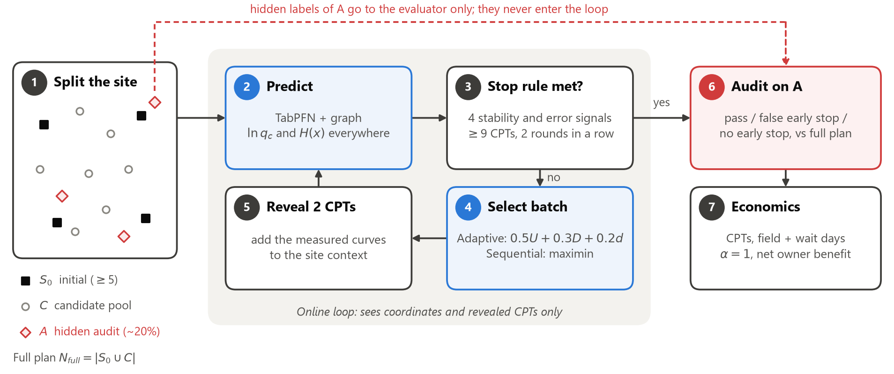
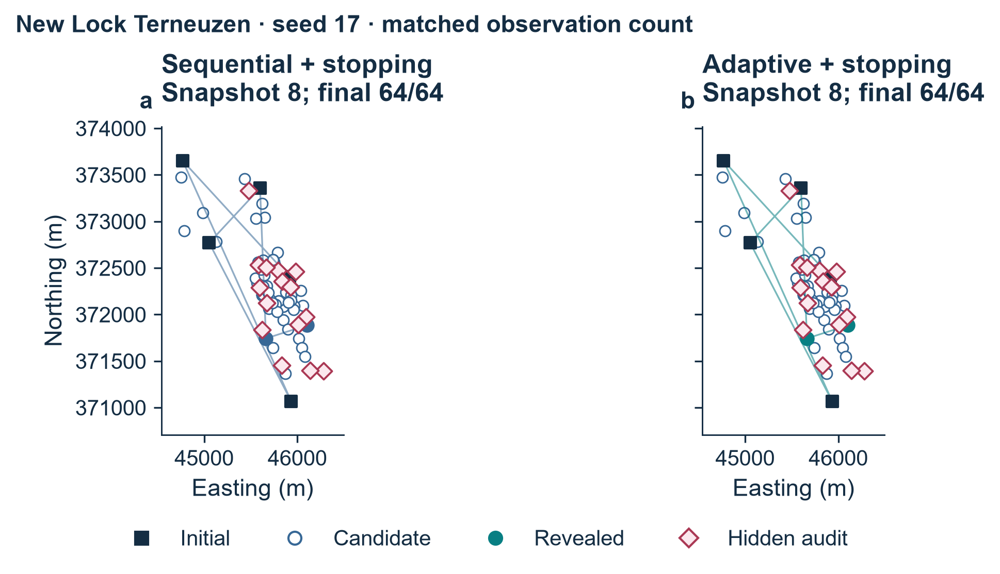
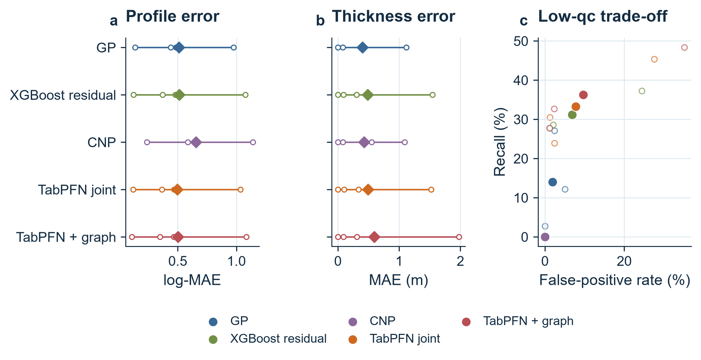
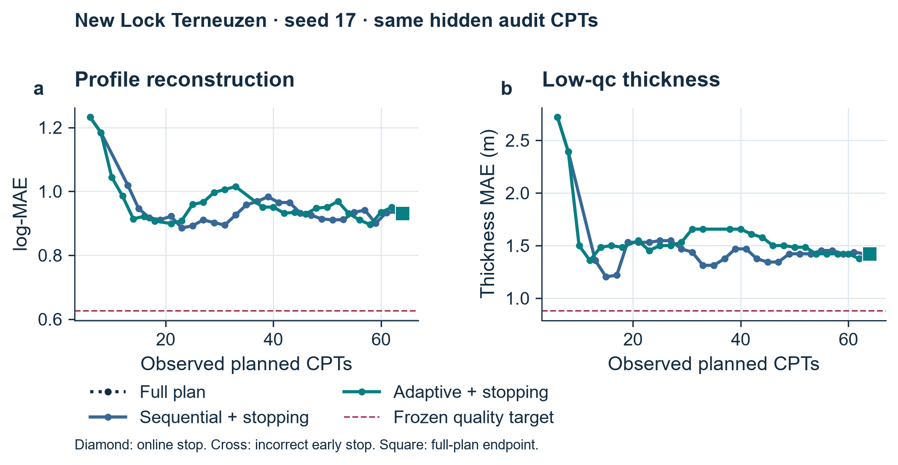
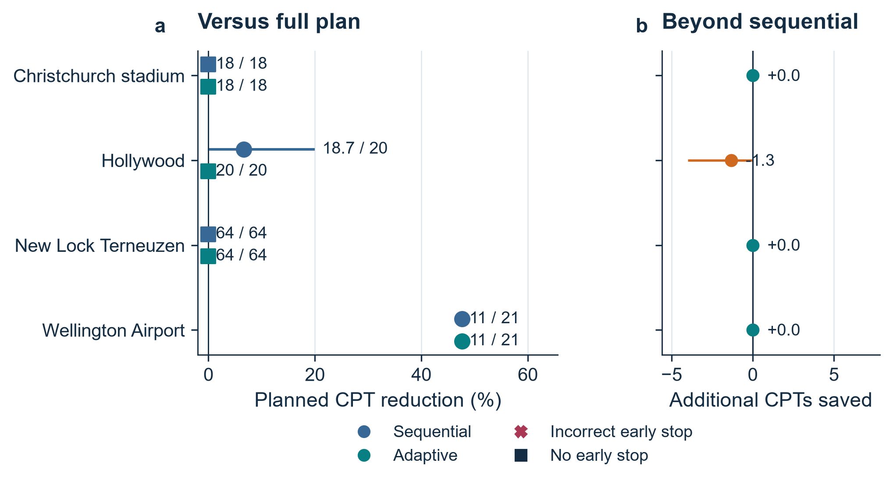
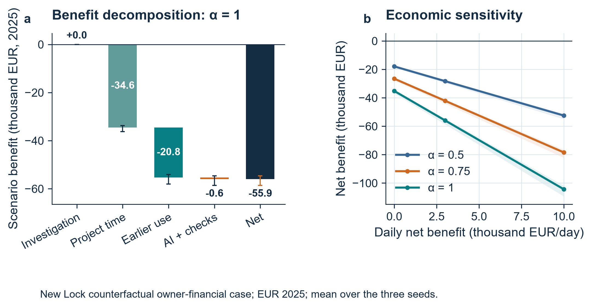

# Machine Learning Guided Adaptive CPT Investigation and Economic Benefit Assessment

CA6001 Applied AI Algorithms Project

Technical report

Student names ____________________________

17 October 2026

A study of shallow cone-resistance prediction, adaptive supplementary investigation and project economic scenarios.

<!-- PAGE -->

## 1 Introduction

Cone penetration testing (CPT) measures vertical ground variability but leaves uncertainty between soundings. Further measurements require site operations, interpretation time and expenditure. The practical question is how many supplementary CPTs are needed, and where they provide the most useful information.

This study compares five AI predictors, then links a selected model to adaptive location selection, online stopping and an independent quality audit. Measured replay workloads feed an economic assessment of investigation cost and programme effects. TabPFN joint reduces evaluation profile error by 2.87% against XGBoost. The frozen adaptive policy saves 47.6% of CPTs at Wellington Airport, but does not improve on matched maximin early stopping and gives no CPT reduction at New Lock.

Guan et al. (2022) demonstrated adaptive CPT numbers and locations for liquefaction assessment using information entropy and Bayesian compressive sampling. Here the targets are shallow cone resistance and cumulative low-resistance thickness. The contribution connects modern AI prediction to investigation and economic decisions, while separating the value of adaptive ordering from the value of early stopping.

## 2 Problem Definition

At position x and depth z, the regression target is y(x,z) = ln(qc/MPa). The 2–8 m window contains 24 cells of width 0.25 m. The event qc < 1 MPa has cumulative thickness H(x) = 0.25 Σk I[y(x,zk) < 0], in metres, including disconnected low-resistance intervals.

The decision task selects positions and a stopping time from a fixed pool, seeking fewer CPTs at pre-specified profile and thickness quality. Hidden locations provide an independent audit. The 1 MPa event is a research target, not a soil-classification or design-safety criterion. Economics concerns only the supplementary task validated here.

<!-- PAGE -->

## 3 Dataset Description

The public Global-CPT collection contains 1,196 soundings from 59 sites or regions; 35 have multiple soundings with known coordinates (ISSMGE Technical Committee 304 [TC304], n.d.; Ching et al., 2023). The separately listed New Lock collection is already included and is not counted twice.

Screening retains 492 representative profiles with complete 24-cell windows. Eight replay sites contain 271 positions; the remaining 221 positions lie outside the decision-replay cohort. Table 1 distinguishes the sampling units.

Table 1. Current data hierarchy and evaluation units.

| Unit | Count | Interpretation |
| --- | --- | --- |
| Source profiles | 503 | Before representative-window filtering |
| Distinct planned positions | 495 | Repeated measurements grouped |
| Usable representatives | 492 | Complete 2–8 m prediction window |
| Sites | 31 | Site is the aggregation unit |
| Cells per profile | 24 | 0.25 m midpoint representation |
| Depth-cell records | 11,808 | Repeated observations within CPTs |

Inputs comprise coordinates, query depth and revealed CPT curves. Neighbour summaries, distances, vertical changes and low-value fractions are derived only from revealed data. Hidden resistance and thickness are excluded.

Resistance is expressed in MPa and log transformed. Curves must cover 2–8 m, with interpolation gaps no larger than 0.5 m. Deterministic representatives remove eight repeated-coordinate profiles; three further profiles fail midpoint completeness. Nearby and duplicate groups stay together across support, candidate and audit roles.

Source spreadsheets are standardised into Parquet profile and depth-grid tables. CSV manifests preserve site, location, group and replay-role identifiers.

Four development sites determine the decision configuration. Four evaluation sites are replayed using seeds 17, 29 and 43, producing 24 site-seed allocations in total. The assigned source checkpoints exclude their target site. Since these sites have a development history, this is a site-held-out re-evaluation, rather than a new blind trial. New Lock retains 80 of 98 original soundings: 15 begin deeper than 2 m and three end shallower than 8 m.

Exact threshold crossings of the piecewise-linear raw curve provide a representation reference. The 0.25 m grid has thickness MAE 0.0925 m and 90th-percentile absolute error 0.2565 m. Among 805 raw low-value intervals shorter than 0.25 m, 498 have no grid midpoint. A 0.1 m diagnostic reduces representation MAE to 0.0335 m. For New Lock, the 0.25 m representation MAE is 0.1389 m. All models nevertheless retain the same 0.25 m output grid, so that comparison measures algorithms consistently.

Errors are averaged within soundings and then equally across sites. This prevents dense sites from dominating. Recall is not applicable to sites without low events. Depth rows and replay seeds are not independent field sites.

<!-- PAGE -->

## 4 Algorithm Selection and Rationale

Five methods compare spatial probability, tree boosting, neural set learning and a tabular foundation model under matched revealed data. Residual models retain an explicitly identified spatial trend.

**Gaussian process.** The GP models departures from a source-site depth trend using a Matérn 3/2 covariance, separate horizontal and vertical length scales, and observation noise. Initial scales are 20, 20 and 1 m, optimised on revealed support. Conditioning gives a prediction mean and standard deviation. Spatial correlation makes this a strong comparator and acquisition model (Rasmussen & Williams, 2006).

**XGBoost residual.** Gradient-boosted trees predict the residual after a local inverse-distance-weighted estimate. Neighbour values, distances and vertical summaries support site-specific correction. Source training uses depth-four trees, learning rate 0.05, at most 500 estimators and validation early stopping. The trees capture nonlinear interactions, making this the principal strong machine learning comparator (Chen & Guestrin, 2016).

**Conditional neural process.** The CNP encodes support profiles with query-relative positions through 64-unit hidden layers, pools by mean and maximum, then decodes by depth. It tests transferable set-to-function learning from a few complete curves (Garnelo et al., 2018). The 26,817-parameter source network received 500–1,200 gradient updates and reduced validation error. A weak result cannot therefore be attributed to an untrained checkpoint alone.

**TabPFN joint.** TabPFN is a Transformer that learns a prediction procedure across synthetic tabular tasks (Hollmann et al., 2025). Here its guarded CPT residual prediction is averaged equally with a triangulation estimate. A support-derived complete-curve decision sets the low-cell count. This is a hybrid: TabPFN supplies half of the amplitude base. The retained v2 checkpoints, loaded with package 9.2.0, received 500–600 successful CRPS-plus-MSE updates. Matched checkpoint comparison confirmed finite learned parameters and actual changes from the pretrained base. These weights remain fixed during context updates in replay.

**TabPFN graph.** This hybrid averages the residual branch with a graph-Huber estimate and labels a cell low if either branch predicts it. Robust spatial smoothing supports coherent profiles. The union rule favours detection, with an expected increase in false positives and low-value thickness.

Selection minimises development log-MAE over registered support states, averaging within seeds and then equally across sites. This selects TabPFN graph (0.5782), ahead of XGBoost (0.5970). Joint gives lower development thickness MAE (0.4826 m). Evaluation results cannot change the selected primary model.

<!-- PAGE -->

## 5 Methodology

### Matched investigation replay

Each site-seed allocation fixes an initial set S0, candidate pool C and hidden audit set A. Spatial maximin initialisation reveals at least five locations in complete groups. The full replay plan S0 ∪ C defines Nfull. A is excluded from every support set and selectable budget. The endpoint is the complete pool.

Bfull completes this plan. Bseq adds maximin batches, choosing groups furthest from revealed CPTs. Padapt adds model-informed batches. Bseq and Padapt share the frozen prediction model, stopping rule and allocation. Their difference isolates adaptive ordering; comparison with Bfull includes the benefit of early stopping.

### Adaptive location selection

Candidate signals are mean GP standard deviation U, low-event model disagreement D and distance to revealed CPTs S. Whole groups receive mean member U and D and minimum support distance. Signals are ranked within the pool. The frozen heuristic is a(x) = 0.5 rank(U) + 0.3 rank(D) + 0.2 rank(S), with XGBoost as the disagreement partner. Development compares this with a U-plus-S alternative; verified savings minus failed-stop frequency selects the configuration.

Batches nominally target two locations, but may exceed two because near groups remain indivisible. Within a batch, distances update after a group is selected while uncertainty and disagreement remain fixed; no selected curve is revealed before the batch is complete. The expanded context is then used for prediction. The development choice is frozen before evaluation.

<!-- PAGE -->

### Online stopping and independent quality assessment

Stopping uses only revealed-data signals. At all full-plan coordinates and the 24 depths, consecutive predictions yield the 90th-percentile change in log resistance and cumulative thickness. A leave-near-group-out diagnostic re-predicts up to five fixed initial groups using the remaining revealed support. GP uncertainty, coverage of populated spatial quadrants and a minimum support count provide further checks. All four signals must pass for two consecutive rounds after at least nine observations and full quadrant coverage. Frozen limits are 0.0815 for log-change, zero for thickness change, 0.5837 for support log-MAE and 0.4613 for GP log-standard-deviation. Only development trajectories select these values.

Research targets are log-MAE ≤0.6265 and thickness MAE ≤0.8813 m, derived from development full-plan 75th percentiles plus predeclared margins. Relative loss against Bfull must not exceed 0.05 log-MAE or 0.25 m. Recall ≥0.5 and false-positive rate ≤0.1 are separate low-event diagnostics. An independent evaluator computes log-MAE, thickness MAE, precision, recall, F1 and false-positive rate on A, then compares stopping with Bfull. Failed early stops remain failures. Without an online trigger, the strategy completes the plan.

### Economic assessment

The owner's direct saving equals complete-plan cost minus AI investigation cost. Time includes production, review, batch waiting and remobilisation. Project advancement is ΔTproject = α ΔTinv; α = 1 is the main scenario, with 0.75 and 0.5 sensitivity cases (U.S. Government Accountability Office, 2015, 2020).

Net benefit is Bnet = Binv + ΔTproject(cday + bday) − CAI. Here cday is avoidable project cost, bday incremental owner operating cash flow and CAI incremental deployment and review cost. Components do not overlap; user time savings remain separate. Failed early stops are repaired to the full plan, including return-to-site cost and delay.

## 6 Implementation

Separate modules handle modelling, acquisition, stopping, audit and economics. Configuration files freeze site roles, seeds, model versions and thresholds. Exported trajectories preserve selected positions, support counts, online signals and stop reasons; audit labels and scores remain outside the decision engine.

Python 3.11.15 uses PyTorch 2.11.0, scikit-learn 1.9.1, XGBoost 3.2.0 and TabPFN 9.2.0 (Pedregosa et al., 2011; Prior Labs, n.d.; PyTorch Contributors, n.d.). TabPFN runs on an RTX 4080 with 16 GB; CPU thread pools are limited to one.

The exported manifest, configuration, model provenance, trajectories, audit and economic tables support reproduction. Label-perturbation checks verify unchanged online decisions; whole-group counts, full endpoints and economic arithmetic are also checked.

<!-- PAGE -->

## 7 Results and Evaluation

### Prediction and model contribution

E1 compares 63 registered evaluation states per model: 62 distinct observed sets and 11 distinct audit sets across four sites and three seeds. Group-atomic jumps explain the difference from 72 development states. Metrics average states within seeds, seeds within sites, then sites equally; registered states are not independent field samples.

Table 2. Evaluation metrics with equal site weighting. Errors and FPR are minimised; precision, recall and F1 are maximised.

| Model | log MAE | H MAE m | Precision % | Recall % | F1 % | FPR % |
| --- | --- | --- | --- | --- | --- | --- |
| GP | 0.5093 | 0.4003 | 51.8 | 14.0 | 11.5 | 1.9 |
| XGBoost residual | 0.5118 | 0.4851 | 35.1 | 31.2 | 29.7 | 6.9 |
| CNP | 0.6566 | 0.4305 | n/a | 0.0 | 0.0 | 0.0 |
| TabPFN joint | 0.4971 | 0.4914 | 33.2 | 33.3 | 29.7 | 7.8 |
| TabPFN graph | 0.5025 | 0.5947 | 34.3 | 36.3 | 31.4 | 9.6 |

TabPFN joint has the lowest evaluation log-MAE (0.4971), 2.87% below XGBoost. The frozen graph primary achieves 1.81% lower error and 36.3% recall, with 9.6% FPR. GP has the best thickness MAE (0.4003 m) but only 14.0% recall. Thus prediction, thickness and detection favour different methods; evaluation does not retrospectively change the selected primary.

Matched E2 variants show that source adaptation improves raw residual log-MAE from 0.5065 to 0.5024. It does not improve the joint pipeline: unadapted joint is 0.4954, versus 0.4971 after adaptation. Domain residual features and spatial/curve decisions therefore make a separate contribution; gradient adaptation does not guarantee improvement in every hybrid.

<!-- PAGE -->

### Investigation workload and quality at stopping

Each incremental policy has 12 evaluation replays. Adaptive and sequential early stops are 3/12 and 4/12, with zero failed early stops and 9/12 final research-quality passes for each. No-early-stop counts are 9/12 and 8/12. Site-equal CPT reductions are 11.90% and 13.57%, respectively.

At New Lock, all 64 planned CPTs are completed. Even Bfull means of 0.9090 log-MAE and 1.349 m thickness MAE exceed the frozen 0.6265 and 0.8813 m targets.

Airport stops at 11/21 in all seeds. Hollywood seed 17 stops at 16/20 sequentially but 20/20 adaptively; no adaptive pair uses fewer CPTs. None of the nine event-containing audits per policy passes the separate low-event diagnostic.

<!-- PAGE -->

### Economic value and sensitivity

New Lock Terneuzen, fully operational from 1 August 2025 (Rijkswaterstaat, 2025), supplies historical data for a counterfactual supplementary-CPT scenario. Replacement concerns the validated shallow task; statutory and deep-design tests remain common.

Table 3. Owner-financial scenario inputs in EUR at a 2025 price level.

| Input | Main value | Evidence status |
| --- | --- | --- |
| All-in CPT / planned depth | €750 / 20 m | Scenario assumptions |
| Production / equipment | 5 CPT/rig/workday; 1 rig | Scenario assumptions |
| Batch waiting | 0.25 calendar day | Scenario assumption |
| Project cost / owner cash flow | €5,000 / €3,000 per calendar day | Scenario assumptions |
| AI deployment and review | €600 | 4 h scenario at MOS €150/h |
| Extra mobilisation / repair wait | €560 / 2 days | MOS price analogue / assumption |

New Lock completes 64/64 CPTs. Batch release adds 6.92 calendar days, producing mean net loss €55,933 (individual losses €54,600–€58,600), with zero direct saving.

Productive workdays are ceil(N/5), converted to calendar days by 7/5. Mobilisation and adviser rates use MOS Grondmechanica (2025); other inputs are assumptions. Airport’s transferred Dutch scenario yields +€23,300 and 2.05 days saved; these are scenario values, not a local contract estimate.

At α = 0.5 and 0.75, New Lock mean losses remain €28,267 and €42,100. Zero batch waiting leaves €600 loss; unit CPT price cannot change this when completed counts are equal.

<!-- PAGE -->

## 8 Discussion and Insights

The best profile result preserves a spatial trend while adding TabPFN residual information and complete-curve decisions. This structure captures local context beyond a generic tabular fit. The graph hybrid obtains more detections at higher false-positive and thickness error. CNP’s zero recall despite genuine training shows how a modest thickness MAE can arise by predicting no low intervals when these are uncommon. Mixed fine-tuning results support judging the complete prediction pipeline.

Early stopping works at Airport, where the audited curves contain no low events. It does not establish low-layer detection. Adaptive ordering never reduces CPT count below its paired maximin result. At New Lock, all five AI models miss full-plan quality targets; even GP gives log-MAE 0.8365 and thickness MAE 0.9948 m. Adaptive support leave-out error stays above 0.805, against the 0.5837 limit, preventing an unjustified early stop despite falling plan uncertainty.

Nearby CPTs can disagree on thin layers and resistance extremes. Low average profile error can conceal missed low intervals, while stable predictions can reflect smoothing rather than sufficient information. Independent post-stop checks keep the decision tied to investigation quality.

The economic bottleneck is a field-process effect: small sequential batches incur release waits without reducing New Lock workload. A prospectively validated larger-batch or integrated-review process could change this balance. Airport illustrates positive conditional value from early stopping, while New Lock shows why a prediction improvement alone cannot be converted into a saving claim.

The four evaluation sites support a descriptive re-evaluation. Confirmation on new investigations with engineer-defined acceptance criteria and actual project prices is the next evidence step.

A prospective pilot should specify mandatory locations, accepted quality, actual prices and programme dependencies. Stored trajectories support this by retaining chosen positions, stop reasons, audit outcomes and their effects on cost and time.

## 9 Conclusion

The implemented workflow connects five AI predictors, group-consistent investigation replay, hidden-label stopping audits and project economics. TabPFN joint improves profile log-MAE by 2.87% over XGBoost, while GP remains strongest for thickness. The frozen graph policy saves 10 of 21 CPTs at Airport, matching maximin early stopping, but provides no additional selection benefit. New Lock remains unresolved at the full budget and has a negative economic scenario. The supported outcome is task-specific prediction progress and a working, auditable decision chain; reliable economic gains remain site dependent.

<!-- PAGE -->

## 10 References

Chen, T., & Guestrin, C. (2016). XGBoost: A scalable tree boosting system. In *Proceedings of the 22nd ACM SIGKDD International Conference on Knowledge Discovery and Data Mining* (pp. 785–794). https://doi.org/10.1145/2939672.2939785

Ching, J., Uzielli, M., Phoon, K. K., & Xu, X. J. (2023). Characterization of autocovariance parameters of detrended cone tip resistance from a global CPT database. *Journal of Geotechnical and Geoenvironmental Engineering, 149*(10), 04023090. https://doi.org/10.1061/JGGEFK.GTENG-11214

Garnelo, M., Rosenbaum, D., Maddison, C., Ramalho, T., Saxton, D., Shanahan, M., Teh, Y. W., Rezende, D., & Eslami, S. M. A. (2018). Conditional neural processes. *Proceedings of Machine Learning Research, 80*, 1704–1713. https://proceedings.mlr.press/v80/garnelo18a.html

Guan, Z., Wang, Y., & Zhao, T. (2022). Adaptive sampling strategy for characterizing spatial distribution of soil liquefaction potential using cone penetration test. *Journal of Rock Mechanics and Geotechnical Engineering, 14*(4), 1221–1231. https://doi.org/10.1016/j.jrmge.2022.01.011

Hollmann, N., Müller, S., Purucker, L., Krishnakumar, A., Körfer, M., Hoo, S. B., Schirrmeister, R. T., & Hutter, F. (2025). Accurate predictions on small data with a tabular foundation model. *Nature, 637*, 319–326. https://doi.org/10.1038/s41586-024-08328-6

ISSMGE Technical Committee 304. (n.d.). *CPT databases*. Retrieved October 17, 2026, from https://tc304.org/cpt_databases.html

MOS Grondmechanica B.V. (2025, May 1). *Offerte A2501409: Realisatie appartementencomplex De Spiegelhoek/Bussum/2501236* [Quotation]. https://www.spieghelhoek.nl/wp-content/uploads/2025/08/offerte-Mos-Realisatie-appartementencomplex-De-Spiegelhoek-010525-003.pdf

Pedregosa, F., Varoquaux, G., Gramfort, A., Michel, V., Thirion, B., Grisel, O., Blondel, M., Prettenhofer, P., Weiss, R., Dubourg, V., Vanderplas, J., Passos, A., Cournapeau, D., Brucher, M., Perrot, M., & Duchesnay, É. (2011). Scikit-learn: Machine learning in Python. *Journal of Machine Learning Research, 12*, 2825–2830. https://jmlr.org/papers/v12/pedregosa11a.html

Prior Labs. (n.d.). *TabPFN* (Version 9.2.0) [Computer software]. https://github.com/PriorLabs/TabPFN

PyTorch Contributors. (n.d.). *PyTorch* (Version 2.11.0) [Computer software]. https://pytorch.org/

Rasmussen, C. E., & Williams, C. K. I. (2006). *Gaussian processes for machine learning*. MIT Press. https://gaussianprocess.org/gpml/

Rijkswaterstaat. (2025, September 1). *New Lock Terneuzen fully operational from 1 August 2025*. https://www.rijkswaterstaat.nl/en/news/archive/2025/09/new-lock-terneuzen-fully-operational-from-1-august-2025

U.S. Government Accountability Office. (2015). *GAO schedule assessment guide: Best practices for project schedules* (GAO-16-89G). https://www.gao.gov/products/gao-16-89g

U.S. Government Accountability Office. (2020). *Cost estimating and assessment guide: Best practices for developing and managing program costs* (GAO-20-195G). https://www.gao.gov/products/gao-20-195g
