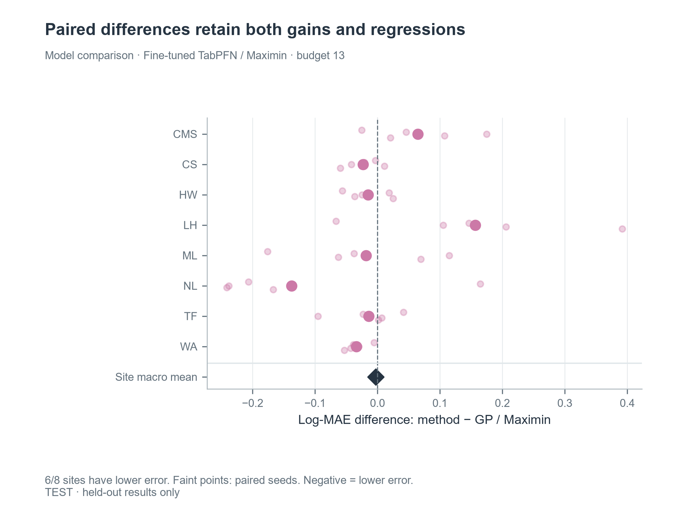
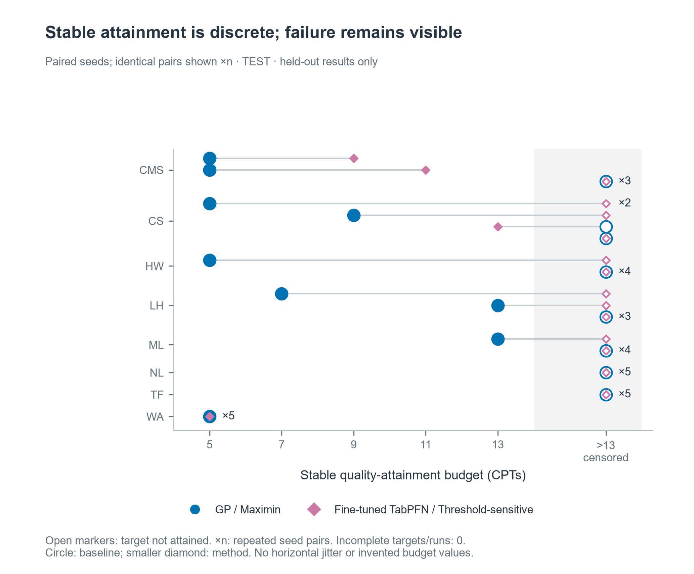

# 首次完整实验结果 · 2026-10-13

核心实现与主实验已经跑通，但本次结果**不支持将“微调基础模型＋阈值敏感选址可以稳定减少补勘”写成已证实结论**。微调改善了原始 TabPFN 的误差与区间覆盖率；简单 IDW 在当前主误差指标上仍然更强，选址收益需要按场地及指标解释。

## 实验范围与复现

- 正式三折源训练；8 个回放场地、5 个固定种子、5/7/9/11/13 根预算。
- 概率模型 3×3 策略矩阵为360条曲线；加上IDW和XGBoost的maximin，共440条测试曲线、2,200行测试指标。
- 另有30条验证曲线，只用于冻结每折质量门槛，不混入测试结果图。
- 492个可用位置、31个场地、24个深度单元；4个场地的全球位置分组仍未核实，限制外部独立性解释。
- 30项自动检查通过，完整运行没有任务执行失败。代码与训练版本见 `experiment_summary.json`、`training_summary.json`。

本机完整产物位于 `runs/main-20261013/`，从项目根执行：

```powershell
.venv/Scripts/python.exe -m cpt_budget run --run full-main --resume
```

它会新建或继续指定run；原始输入按仓库README恢复。复用本机已完成结果可执行 `status --run main-20261013`、`export --run main-20261013`。

## 相同布点下的模型比较

以下固定 **maximin、预算13根**，先平均每场地的五个种子，再对8场地等权平均。厚度是2–8m窗口内低于1MPa的网格厚度，不等于真实土层分类。

| 模型 | log-MAE ↓ | log-RMSE ↓ | 点厚度MAE（m）↓ | 90%区间实测覆盖率 |
|---|---:|---:|---:|---:|
| IDW | 0.5515 | 0.7137 | 0.5301 | 不提供区间 |
| GP | 0.5793 | 0.7281 | 0.5749 | 85.00% |
| XGBoost | 0.6401 | 0.7864 | 0.6663 | 不提供区间 |
| 未微调TabPFN v2 | 0.6308 | 0.8060 | 0.6156 | 47.95% |
| 微调TabPFN v2 | 0.5768 | 0.7357 | 0.6806 | 85.40% |

微调相对未微调的宏平均log-MAE下降约8.55%，但点厚度误差变大。相对GP，微调版在6/8场地的log-MAE更低，宏平均却仅有很小差异，不能把场地胜数当成普遍大幅改善。区间覆盖率从47.95%提升到85.40%，仍未达到名义90%，也不等于严格覆盖保证。

覆盖整个5–13根预算的归一化log-MAE曲线面积，IDW为0.5738、GP为0.5905、微调TabPFN为0.6122。当前结果没有显示复杂模型在整体预算曲线上超过简单插值。



## 固定微调模型后的选址比较

| 策略，预算13根 | log-MAE ↓ | 点厚度MAE（m）↓ |
|---|---:|---:|
| maximin | 0.5768 | 0.6806 |
| 普通不确定性 | 0.5679 | 0.6364 |
| 低锥阻阈值敏感 | 0.5838 | 0.6273 |

阈值敏感规则在这里降低了点厚度误差，却没有同时降低整体剖面误差。它是可检验的启发式规则，本次证据不能把它描述为更优的通用选址策略。首轮同信息状态下的重合度与评分相关见 `selection_diagnostics.csv`。

## 同质量达标与成本

比较微调TabPFN＋阈值敏感选址与GP＋maximin，共40个场地／种子配对：

| 达标构成 | 实例数 |
|---|---:|
| 双方均稳定达标 | 7 |
| 仅微调＋阈值策略达标 | 1 |
| 仅GP＋maximin达标 | 7 |
| 双方均未在13根内稳定达标 | 25 |

双方均达标的7例中，`基线根数 − 方法根数` 平均为 **−1.43根**，即本方法平均多用约1.43根；具体差值为−6、−4、0、0、0、0、0。这些只是17.5%的配对实例，不能省略其余未达标结果。没有实际报价，因此不生成货币节约额。



## 如何使用这批产物

- `model_policy_macro.csv`：各模型／策略／预算的场地宏平均；`budget_curve_macro.csv`：曲线面积。
- `test_metrics.csv`：完整2,200行测试指标，保留阴性场地和缺失原因。
- `attainment.csv`、`costs.csv`：完整达标与配对构成；`quality_targets.json`：验证集冻结的门槛。
- `folds.json`：实际三折分组及未核实组；`training_summary.json`：源训练、版本与权重标识。
- `figures/`：可直接查看的代表图。完整六类图的报告/幻灯片版仍在本机run目录。
- 本机 `runs/main-20261013/demo/new_lock_replay.mp4`：51秒、17状态的真实回放演示；不是最终课程讲解录制。

当前适合将课程报告组织为“基础模型微调、简单空间基线与选址权衡的比较研究”。完整课程报告、12张内容幻灯片及团队录制尚未制作。Delft、0.1m网格与额外阈值敏感性属于后续扩展；不能根据这批测试表现再挑阈值并称为同一次预先固定实验。
