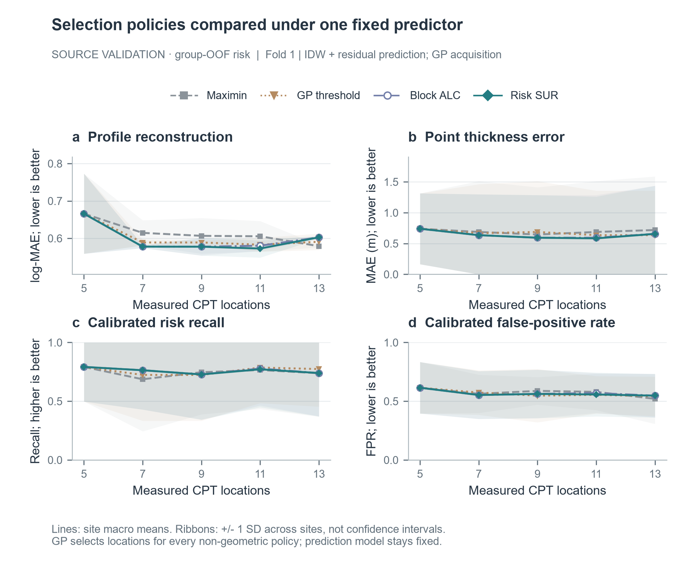

# CPT v0.2：实现完成，验证未达到扩大测试门槛

完成日期：2026-10-14。完整运行：`v2-validation-20261013-r2`，名称保留启动日期。代码位于 `feat/v0.2-risk-aware`，结果标签为 `v0.2-validation`；v0.1结果及默认流程保留。

**新版功能和三折验证均已完成，但尚未实现稳定节省CPT根数的核心预期。** 按不同验证场地等权汇总，选中组合的预算平均log-MAE由0.629755降至0.621098，改善1.37%；4个不同场地中2个改善、2个因回退而持平，未通过“多数场地改善”的预定条件。因此没有启动五种子外层测试，也不宣称获得10%根数节约。

## 本版实际交付

- 24维空间与垂向表示：固定10/50m物理长度核统计通过完整官方TabPFN预处理后仍能保留尺度差异。
- 新表示下的原始TabPFN、CRPS＋MSE微调、增加低值CDF Brier目标的任务微调；统一记录最佳权重和训练结束时的数据曝光率。
- 有厚度、Recall、FPR护栏及纯IDW回退的残差模型。
- 按验证勘察组留一的风险校准；原点预测与风险指标分别保存。
- GP整根24单元ALC与风险SUR选址，第二根使用条件信息，批次确定后才揭示真值。
- 完整验证键检查、每折候选选择、重复验证场地去重后的全局扩展门槛，以及独立CLI、结果表和报告／演示图。
- 混合精度溢出恢复：同一episode降低缩放重试，必要时真正FP32重试；失败尝试不计更新或推进数据曝光。

实现接口与预定规则见[实现共识](../../docs/V2_IMPLEMENTATION_CONTRACT.md)，操作见[运行说明](../../docs/V2_RUN_GUIDE.md)。

## 覆盖范围与口径

使用同一492个可用位置、31个场地数据范围；源训练三折，两种子17/29验证，预算5/7/9/11/13。六个模型ID完成72条全预算模型验证曲线（360个预算行）；固定预测器后四类选址完成96条全预算策略曲线（480个预算行）。验证回放覆盖6个fold/site组合，但仅有**4个不同场地**，重复场地先平均fold，不能当作6个独立场地。

六个微调候选共完成2100次有效更新。各候选训练结束时已覆盖全部预定query块；选中的最佳checkpoint较早，不能把最终曝光率归给最佳权重。

| fold_id | CRPS / 任务微调有效更新 | 两者最佳step | 最佳权重query块覆盖率 |
|---|---:|---:|---:|
| 0 | 400 / 400 | 50 | 54.17% |
| 1 | 200 / 200 | 50 | 61.76% |
| 2 | 450 / 450 | 100 | 69.74% |

OOF在这里仅指**校准映射按勘察组留一**。模型、checkpoint和策略仍使用验证数据选择，本表不是独立泛化证明。v0.1外层结果已被查看，新版被明确登记为探索性第二轮；本轮未生成新的外层测试结果。

## 预测器与策略选择

所有门槛统计量先对预算作归一化梯形积分，再平均种子和场地。AUBC在这里是预算区间内平均误差，数值下降不是根数节约率。

| fold_id | 强基线 | 选中预测器 | 选中策略 | log-MAE AUBC：基线 → 组合 | 组合风险FPR |
|---|---|---|---|---:|---:|
| 0 | IDW＋maximin | IDW | GP threshold | 0.616535 → 0.601095 | 60.75% |
| 1 | IDW＋maximin | IDW残差 | GP threshold | 0.616535 → 0.597347 | 56.34% |
| 2 | GP＋maximin | GP | maximin回退 | 0.642976 → 0.642976 | 11.59% |

新TabPFN候选在三折均未晋级：预测误差没有胜过相应强基线，部分候选还未通过厚度或风险护栏。残差模型只在fold 1通过，固定maximin下误差改善约0.68%。

ALC/SUR在前两折有更低的平均误差候选，但只改善其中1/2验证场地，未满足该折多数场地同向改善条件；fold 2的三种新选址均未通过，保留maximin。选址复杂度增加没有转化为稳定跨场地收益。

| 不同验证场地 | 组合相对基线的log-MAE AUBC下降 |
|---|---:|
| Christchurch Metro Sports Facility | 0.00%（回退） |
| Lower Hutt Town Hall | 0.24% |
| Marshland | 0.00%（回退） |
| Tauranga Farmers Building | 5.26% |

全局等场地结果：H_point平均绝对误差0.6450→0.6340m；风险Recall 62.14%→62.60%；风险FPR 36.68%→35.07%。护栏通过，但场地多数条件失败，`expand_test=false`。完整候选、失败条件和配对证据分别见[模型选择](model_selection.json)、[策略选择](policy_selection.json)和[逐场地比较](selected_system_by_site.csv)。

## 仍未解决的核心问题

1. **跨场地风险校准仍不可靠。** 前两折选中组合误报率约56%–61%，TabPFN部分候选接近75%。0.2风险阈值来自研究情景的漏判／误报成本4:1，不能把高Recall单独解释成可靠识别。每折只有两个回放验证场地，校准迁移证据很弱。
2. **联合可达目标解决了数学上的参考可达性，但没有保证目标足够有用。** 所选q为0.6/0.8/0.8，参考联合通过率50%/100%/100%；fold 2的Recall下限甚至为0。这类目标必须另行结合研究价值约束，不能据此宣称已达到有效风险控制。旧边际规则是在同一本轮验证集上重算的对照，并非v0.1五种子冻结阈值；新旧门槛下的成本节约不能混用。
3. **修复表示、训练与批量选址后，TabPFN仍未胜过空间强基线。** 本轮证据支持继续把IDW/GP作为主线，并把跨场地迁移、低值事件的可学信号和选址收益不稳定作为后续研究问题；没有证据支持仅增加训练步数或复杂选址就能达到核心预期。

## 检查与复现

27项v0.2定向测试全部通过，覆盖整位置隔离、目标阈值变换、风险校准隔离、完整预算键、GP条件协方差、批量选择及AMP恢复。真实GPU验证还确认了溢出后同episode恢复、仅一次有效更新和权重保存／重载一致性。正式完整流程正常结束；最终图已重新导出并检查代表性策略图和晋级图。

初始运行`v2-validation-20261013`的混合精度失败记录仍保存在本地；修复后从原始权重启动r2，没有从中断checkpoint冒充完整训练。六个训练产物记录的源码版本为`5fd3a28`；最终集成与全局门槛修复在`98f05f9`，最终图包含本次结果提交中的绝对FPR注释修正。

```powershell
# 从Project根目录启动新运行；失败的全局门槛会自然结束于验证阶段
.venv/Scripts/python.exe -m cpt_budget.v2 run --run my-v2-run --resume

# 本机查看已完成结果；不会重新训练
.venv/Scripts/python.exe -m cpt_budget.v2 status --run v2-validation-20261013-r2
.venv/Scripts/python.exe -m cpt_budget.v2 export --run v2-validation-20261013-r2
```

本目录归档配置、划分快照、全部模型／策略验证指标、候选门槛、训练与数值恢复摘要、质量表以及带源表的报告／演示图。大体积模型权重、逐深度预测及任务缓存保存在本机`runs/v2/v2-validation-20261013-r2/`，不提交Git；重新计算仍需按仓库数据说明恢复原始包并运行流水线。归档文件校验和见`artifact_manifest.json`。

关键Git节点：`6ce8bdb`共识冻结 → `e7c9284`表示／模型／校准 → `d98e3e8`选址与回放 → `5fd3a28`数值恢复 → `98f05f9`全局门槛 → `54bda58`训练证据 → `v0.2-validation`完整验证交付。


